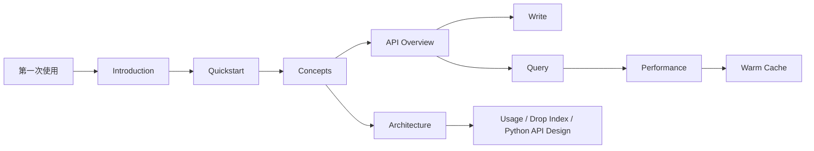

# LakeSoul 向量检索文档

本目录介绍 LakeSoul 的向量检索能力，包括入门、架构、概念、性能、API、
写入、查询和缓存。

LakeSoul 是湖仓一体框架，向量索引是表上的二级索引；数据仍然由 LakeSoul 的
事务、分区、merge-on-read 和快照语义管理。

## 文档导航

| 页面 | 内容 | 适合读者 |
|---|---|---|
| [Introduction](introduction.md) | 定位、能力、设计目标、取舍 | 所有人 |
| [Quickstart](quickstart.md) | 建表 → 写数据 → 建索引 → 查询 | 第一次使用 |
| [Roadmap & Changelog](roadmap-and-changelog.md) | 已实现能力、后续规划、变更记录 | 跟进开发 |
| [Architecture](architecture.md) | PG + 对象存储 + IVF/RaBitQ + 缓存的分层 | 想了解内部实现 |
| [Concepts](concepts.md) | 表/主键、索引 shard、nprobe、recall 等 | 需要理解术语 |
| [Performance](performance.md) | 核心参数、冷热查询、批量和调优建议 | 上线/调优 |
| [同条件QPS优化分析](native-qps-optimization-analysis.md) | 原始延迟分布、普通单查与batch瓶颈、源码证据及A/B验证顺序 | 性能/引擎开发 |
| [API Overview](api-overview.md) | Python / SQL / Rust / pgvector 入口 | 集成开发 |
| [Write](write.md) | 建表、写入、自动建索引、补建、重建、删除行 | 数据工程师 |
| [Query](query.md) | `table.search`、SQL、过滤、exact/index-only、批量 | 查询开发 |
| [Native SQL Batch](../native-batch-sql.md) | DataFusion/pgwire一次SQL批量检索、内核并行、快照与资源预算 | 批量查询/集成开发 |
| [Native Batch Validation](native-batch-validation.md) | 正确性、双worker、协议、读租约与JVM适配器验证记录及限制 | 审查/部署 |
| [Warm Cache](warm-cache.md) | L1/L2 缓存、预热、索引 SSD、各引擎差异 | 性能/运维 |

## 参考

| 页面 | 内容 | 适合读者 |
|---|---|---|
| [Usage](usage.md) | 完整使用说明：SQL / Python / Daft / Native Rust、配置、调优、错误 | 集成开发 |
| [Drop Index](drop-index.md) | 删除向量索引 API、语义、状态机、GC | 运维/数据治理 |
| [Python API Design](python-api-design.md) | Python 接口设计与实现进度 | 跟进开发 |

## 深入与实验记录

> 缓存细节已合并到 [Warm Cache](warm-cache.md)，批量查询与压测数据已合并到 [Performance](performance.md)。

| 页面 | 内容 | 适合读者 |
|---|---|---|
| [向量查询使用说明](向量查询使用说明.md) | DataFusion 单查询 SQL / 批量入口、参数与工作点 | 查询开发 |
| [向量检索方案对比](向量检索方案对比-最初与现在.md) | 最初 vs 现在：设计原因、A/B 与验收数据 | 架构/调优 |
| [向量查询优化日志](向量查询优化日志.md) | 逐轮改动、证据、A/B、回滚记录 | 跟进性能优化 |
| [端到端 QPS 分析](端到端向量检索QPS分析与优化方案.md) | 端到端链路、瓶颈分析与优化方案 | 性能/架构 |

## 相关文档

- [architecture.md](architecture.md)：更详细的内部架构
- [usage.md](usage.md)：完整使用说明
- [drop-index.md](drop-index.md)：删除索引 API
- [tutorial/](../tutorial/)：按使用方式拆分的教程

## 约定

- 示例默认使用本地 `file://` 路径，方便直接运行；S3/MinIO 只需把 path 和
  object store options 换掉。
- 所有“性能数字”都是参考值，依赖硬件、数据分布、缓存状态和参数。
- 当前向量索引支持 `L2` 和 `IP`；`cosine` 需要先归一化或走精确扫描。
