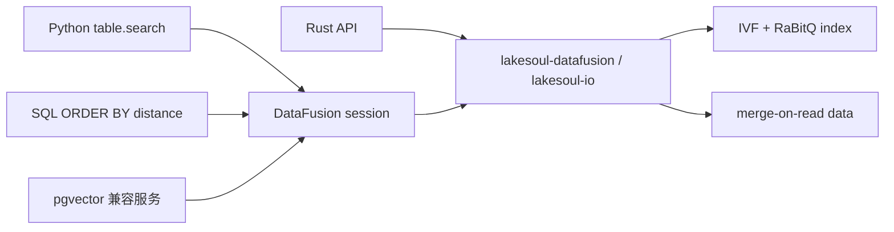

# API Overview

LakeSoul 向量检索有四个主要入口：

| 入口 | 适合场景 | 入口对象 |
|---|---|---|
| Python | 数据工程、Notebook、脚本 | `LakeSoulCatalog` / `LakeSoulTable` |
| SQL / DataFusion | 数仓 SQL、报表、BI | `LakeSoulSession.sql` / DataFusion `SessionContext` |
| Rust | 引擎集成、服务端 | `lakesoul-datafusion` / `lakesoul-io` |
| pgvector 兼容服务 | 存量 pgvector 应用 | `postgres-lakesoul` + `psycopg` |

---



## 1. Python

### 建表/写入/查询

```python
from lakesoul import LakeSoulCatalog

catalog = LakeSoulCatalog.from_env(namespace="default")
table = catalog.table("docs")

table.write_arrow(rows)                       # 自动维护索引
table.build_vector_index()                    # 历史数据补建
table.rebuild_vector_index()                  # 全量重建
table.drop_vector_index(column="embedding")   # 删除索引
```

### 查询

```python
table.search(q, top_k=10, rerank="exact")
table.search(q, top_k=10, rerank="index", with_distance=True)
table.search_batch([q1, q2], top_k=10, rerank="index")
```

### 表信息

```python
table.vector_index_columns
table.path
table.primary_keys
table.hash_bucket_num
```

---

## 2. SQL / DataFusion

```sql
SET lakesoul_vector_search.nprobe = 64;
SET lakesoul_vector_search.rerank = 'exact';

SELECT id, title
FROM "lakesoul"."default"."docs"
ORDER BY array_distance(embedding, ARRAY[1,0,0,0])
LIMIT 10;
```

- 支持 `array_distance`（L2，ASC）和 `inner_product`（IP，DESC）；
- `EXPLAIN` 中出现 `LakeSoulVectorSearchExec` 表示下推成功；
- 多列加权融合可以用 `a*d1 + b*d2` 形式；
- 一次原生批量检索使用 `lakesoul_vector_search_batch(...)`（inline JSON）或 `lakesoul_vector_search_batch_from_table(...)`（query表），返回 `query_id,rank,id,distance`；两个函数在DataFusion与LakeSoul pgwire中共享实现，计划显示 `VectorBatchSearchExec`，内部有界并行且复用快照/cluster/block。签名、限制和示例见 [Native SQL Batch](../native-batch-sql.md)。

Python 里执行 SQL：

```python
session = catalog.session(vector_search={"nprobe": 64})
session.sql("SET lakesoul_vector_search.rerank = 'index'")
print(session.sql(sql).to_pydict())
print(session.explain(sql))
```

---

## 3. Rust

核心入口：

```rust
use lakesoul_datafusion::vector_index::{
    DropVectorIndexOptions, drop_vector_index,
};

let report = drop_vector_index(
    &client,
    "docs",
    "default",
    &object_store_options,
    DropVectorIndexOptions {
        columns: Some(vec!["embedding".to_string()]),
        ..Default::default()
    },
).await?;
```

表级 API：

```rust
let table = lakesoul_datafusion::lakesoul_table::LakeSoulTable::for_name("docs").await?;
table.rebuild_vector_index().await?;
table.drop_vector_index(Default::default()).await?;
```

底层 crate：

- `lakesoul-vector`：IVF/RaBitQ、segment、mutation、commit；
- `lakesoul-io`：shard builder、search、cache、pk locator；
- `lakesoul-metadata`：index catalog、lease、GC。

---

## 4. pgvector 兼容服务

`postgres-lakesoul` 提供 pgvector 风格的只读 SQL：

```python
import psycopg
from pgvector.psycopg import register_vector

conn = psycopg.connect("host=127.0.0.1 port=6543 user=lakesoul_test dbname=default")
register_vector(conn)
conn.execute("SET ivfflat.probes = 64")
rows = conn.execute(
    "SELECT id FROM docs ORDER BY embedding <-> '[1,0,0,0]' LIMIT 3"
).fetchall()
```

服务只读；建表/写入仍由 Python/SQL/Spark/Flink 完成。

---

## 5. 配置

| 变量 | 作用 |
|---|---|
| `LAKESOUL_VECTOR_CACHE` | 向量缓存总开关 |
| `LAKESOUL_VECTOR_MEMORY_BYTES` | L1 内存预算 |
| `LAKESOUL_CACHE_PATH` / `LAKESOUL_CACHE_SIZE` | L2 SSD |
| `LAKESOUL_INDEX_SSD_BYTES` | 索引文件专用缓存 |
| `LAKESOUL_VECTOR_LAZY_INDEX` | lazy cluster 模式 |

详见 [Warm Cache](warm-cache.md)。

---

## 6. 选择建议

- **只写数据、做 ETL**：Python `write_arrow` / SQL `INSERT`；
- **在线检索服务**：Python `table.search` 或 SQL；
- **已有 pgvector 应用**：`postgres-lakesoul`；
- **深度集成**：Rust API。

下一篇：[Write](write.md)。
