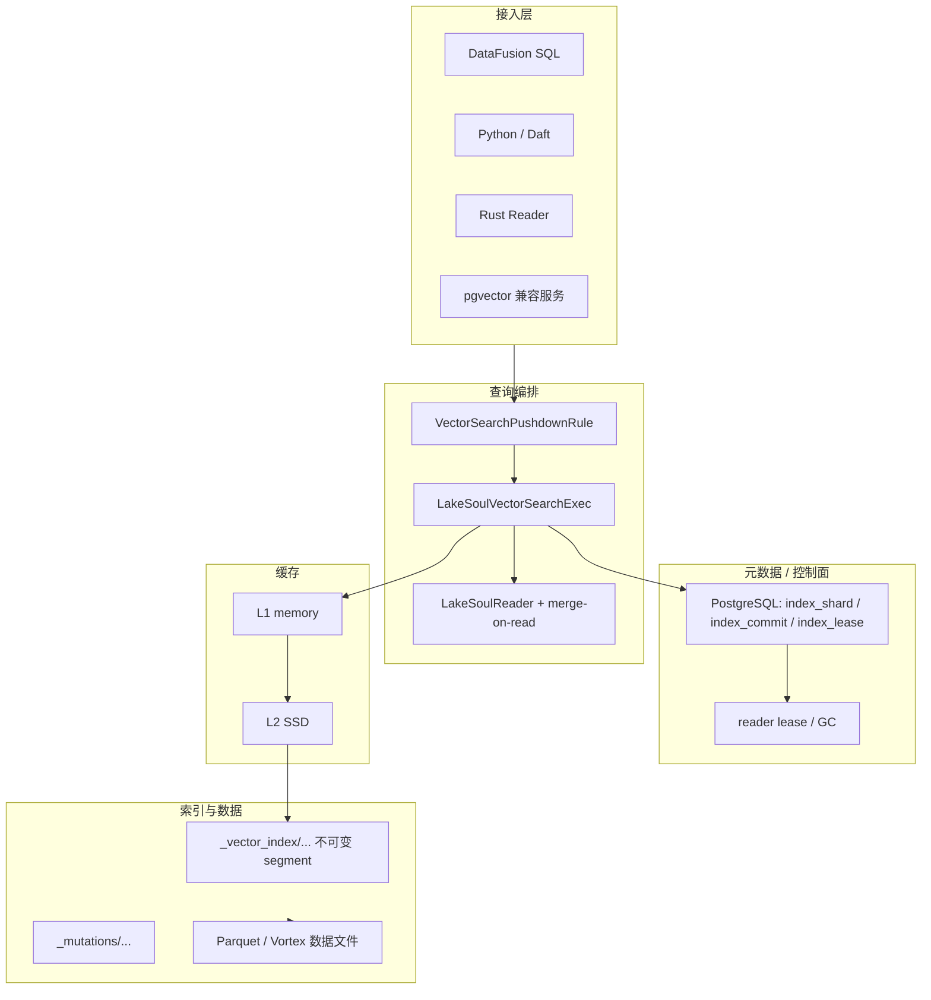
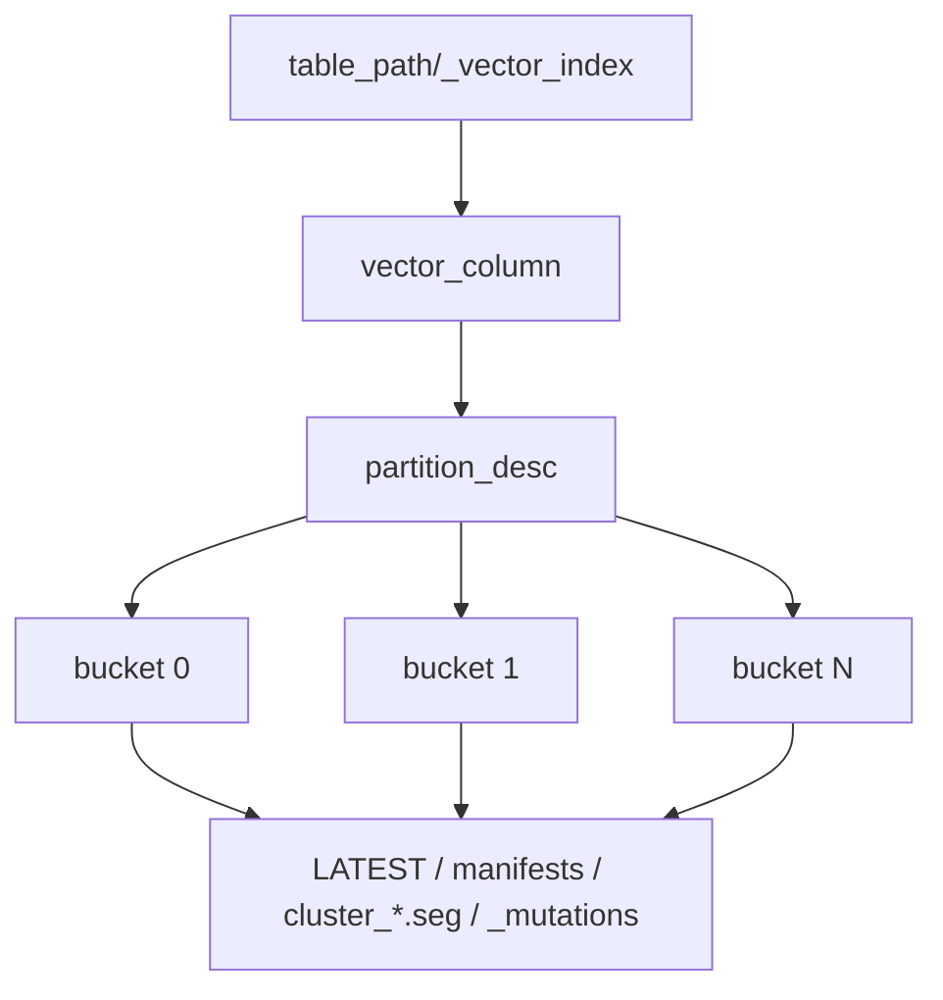
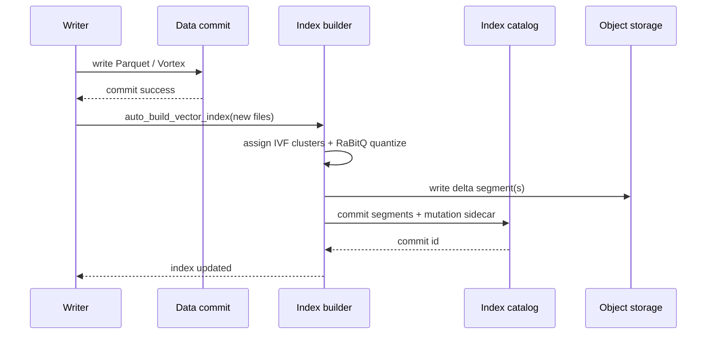
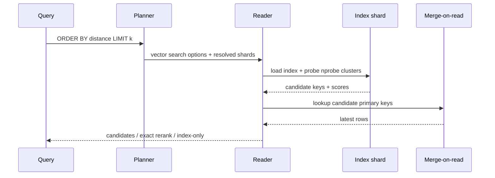

# LakeSoul 向量检索：架构设计

本文描述 LakeSoul 向量检索的整体架构、数据模型、索引构建、查询执行、
ANN 算法，以及 Upsert/Delete 的可见性设计。

- 相关 crate：`lakesoul-vector`、`lakesoul-io`、`lakesoul-metadata`、
  `lakesoul-datafusion`、`python`
- 相关文档：[usage.md](usage.md)、[python-api-design.md](python-api-design.md)、
  [README.md](README.md)

---



## 1. 设计目标与非目标

### 1.1 目标

1. **在 LakeSoul 表上做 ANN top-k**，而不是引入独立的向量数据库；
2. 索引与数据解耦：数据文件仍是普通 Parquet/Vortex，索引是旁路 secondary index；
3. 支持**增量写入**：新数据只追加 delta segment，不重写历史 segment；
4. 支持**分区 + hash bucket**：每个 shard 独立构建、独立检索、可并行；
5. 支持 **Upsert/Delete** 的索引可见性：查询只看到最新副本；
6. 低内存构建：流式量化、按 shard 构建、可并行；
7. 对象存储友好：不可变对象 + catalog CAS + reader lease + GC；
8. 与 LakeSoul 的 **merge-on-read** 语义一致：索引只产生候选 key，
   最终行内容由数据层决定。

### 1.2 非目标

- 不做通用向量数据库（不支持任意过滤语法、事务内多表向量 join 等）；
- 不做 GPU 检索；
- 不做跨表全局 ANN；
- 不支持 `cosine_distance` 下推（当前只支持 L2 / IP）；
- 不保证 ANN 100% 召回（这是近似索引）。

---

## 2. 系统分层

```text
┌──────────────────────────────────────────────────────────────────┐
│ 接入层                                                            │
│  SQL (DataFusion) │ Python/Daft │ Native Reader │ ES Gateway      │
└───────────────┬──────────────────────────────────────────────────┘
                │  解析 top-k / 构造 reader options
                ▼
┌──────────────────────────────────────────────────────────────────┐
│ 查询编排层                                                        │
│  VectorSearchPushdownRule / LakeSoulTableProvider / Daft source   │
│  LakeSoulVectorSearchExec / LakeSoulReader                        │
└───────────────┬──────────────────────────────────────────────────┘
                │  解析 shard、拿 lease、注入候选
                ▼
┌──────────────────────────────────────────────────────────────────┐
│ 索引访问层                                                        │
│  VectorCatalog.resolve → ResolvedIndex                            │
│  index cache (commit_id 校验) + reader lease                      │
│  lakesoul-io/vector/search.rs                                     │
└───────────────┬──────────────────────────────────────────────────┘
                │  load segments + mutation → IvfRabitqIndex
                ▼
┌──────────────────────────────────────────────────────────────────┐
│ 检索引擎层（lakesoul-vector）                                     │
│  IVF + RaBitQ：rotate → LUT → nprobe → FastScan → prune → refine  │
│  → bounded heap → top-k                                           │
└───────────────┬──────────────────────────────────────────────────┘
                │  candidate IndexKey
                ▼
┌──────────────────────────────────────────────────────────────────┐
│ 行读取层                                                          │
│  pk locator / pk IN → MergeParquetExec (merge-on-read)            │
│  CDC delete 过滤 → 最新行                                          │
└──────────────────────────────────────────────────────────────────┘
```

### 2.1 组件职责

| 组件 | 职责 |
|---|---|
| `lakesoul-vector` | 纯计算 + 索引持久化：IVF/RaBitQ、segment、mutation、commit 协议；不依赖 `lakesoul-io` |
| `lakesoul-io` | shard builder、搜索编排、reader 集成、索引前缀、cache、pk locator |
| `lakesoul-metadata` | PostgreSQL catalog：`index_shard` / `index_commit` / `index_lease` |
| `lakesoul-datafusion` | SQL 改写、scan 选择、物理执行、自动构建、GC |
| `python` | PyO3 绑定 + Python/Daft 编排 |

依赖方向：

```text
lakesoul-vector
    ↑
lakesoul-io
    ↑
lakesoul-datafusion / python
```

`lakesoul-vector` 保持无 `lakesoul-io` 依赖，方便单独测试和复用；
`VectorShardIndexBuilder` 放在 `lakesoul-io`，因为它需要通过 `LakeSoulReader`
读取 parquet/vortex。

---

## 3. 数据模型

### 3.1 表、分区与 shard

一个向量索引按 **`(partition_desc, hash_bucket_id)`** 切分为多个 shard：

```text
table
├── partition=2024-01-01, bucket 0  → shard 0
├── partition=2024-01-01, bucket 1  → shard 1
├── partition=2024-01-02, bucket 0  → shard 2
└── ...
```

- `partition_desc`：分区目录相对于表根目录的路径；无分区时为 `-5`；
- `bucket_id`：从数据文件名中解析（`extract_hash_bucket_id`）；
- 每个 shard 有独立的 IVF 索引、独立的 commit、独立的 `top_k` 候选预算。

这样做的原因：

1. 写入天然按 hash bucket 分区，索引构建可以按分片并行；
2. 查询一个 reader 只处理一个 bucket，索引加载/检索局部化；
3. 单 shard 可以独立 rebuild / GC，不影响其他分片。

### 3.2 对象存储布局

```text
{table_path}/
├── part-..._0000.parquet / .vortex           # 数据文件
└── _vector_index/
    └── {vector_column}/
        └── {partition_desc}/
            └── {bucket_id}/
                ├── cluster_0000_0000_<rand>.seg    # base segment
                ├── cluster_0000_0001_<rand>.seg    # delta segment
                ├── cluster_0001_0000_<rand>.seg
                └── _mutations/
                    └── g{generation:08}/
                        ├── <txid>.delta             # LSMD
                        └── <txid>.checkpoint        # LSMC
```

- segment 文件名带 16 位随机后缀，保证并发构建不会覆盖同一对象；
- `data_files`（catalog JSON 字段）记录该 segment 覆盖了哪些数据文件，
  用于发现“索引还没构建”的新文件；
- `_mutations/` 是 Upsert/Delete 的旁路对象，不进入 `.seg`。

### 3.3 Catalog

PostgreSQL 中与向量索引直接相关的表（[script/meta_init.sql](../../../../script/meta_init.sql)）：

```sql
index_shard(
  shard_id bigserial primary key,
  kind text,                    -- 'vector'
  index_prefix text,            -- _vector_index/{column}/{partition}/{bucket}
  unique (kind, index_prefix)
)

index_commit(
  commit_id bigserial primary key,
  shard_id bigint,
  generation bigint,
  version bigint,
  header bytea,                 -- IndexHeader 序列化
  segments jsonb,               -- 该 generation 的累计 segment 列表
  mutation_head text,           -- mutation 链头
  mutation_records integer,     -- 链中对象数
  created_at, superseded_at,
  unique (shard_id, generation, version)
)

index_lease(
  lease_id uuid primary key,
  shard_id bigint,
  generation bigint,
  version bigint,
  owner text,
  acquired_at, expires_at
)
```

要点：

- `index_commit` 的每一行都携带**该 generation 到当前 version 为止的累计
  segment 列表**，所以 `resolve()` 只读一行即可；
- 新 commit 插入新行，旧行保留（`superseded_at` 由 rebuild 标记），用于
  时间旅行/旧 reader；
- lease 防止 GC 删除正在被 reader 加载的 segment；
- 索引数据本身不在 PG 中，只在对象存储。

### 3.4 Segment 文件格式

segment 是不可变对象，格式为 `SEG2`（[segment.rs](../../../../rust/lakesoul-vector/src/rabitq/segment.rs)）：

```text
SEG2
cluster_id       u32
version          u32
padded_dim       u32
ex_bits          u8
num_vectors      u32
centroid         f32 * padded_dim
ids              num_vectors × (len u32 + arrow-Row bytes)
batch_data       len u64 + bytes
                 // 每 32 个向量一批：
                 // [binary codes][f_add × 32][f_rescale × 32][f_error × 32]
ex_codes         count u32 + count × (len u64 + bytes)
f_add_ex         f32 * num_vectors
f_rescale_ex     f32 * num_vectors
delta            f32 * num_vectors
vl               f32 * num_vectors
crc32            u32
```

索引 header 单独序列化在 catalog 的 `header` 字段中，magic 为 `RBQH`，
包含 `dim`、`padded_dim`、`metric`、`rotator`、`ex_bits`、`total_bits`、
`key_kind`（主键布局指纹）。

### 3.5 IndexKey：主键的 arrow-Row 编码

索引里存的是**主键列的 arrow-Row 编码**，而不是行号：

```text
IndexKey = arrow_row_encode(pk_col_1, pk_col_2, ...)
```

- 支持单列和复合主键；
- 编码是顺序保持的，可以直接排序/二分；
- header 里存 `key_kind`（布局指纹），查询时与表当前 schema 比较；
  不一致则**不使用索引**，回退普通扫描；
- 查找行时用同一个 codec 解码成 `pk IN (...)`，或直接交给 pk locator。

### 3.6 版本术语

| 术语 | 含义 | 作用域 |
|---|---|---|
| `generation` | 索引“代” | 一个 shard |
| `version` | 同一 generation 内的提交版本，每次 commit +1 | 一个 shard，全局可比 |
| `segment_version` | 某 cluster 内 delta segment 的序号（0=base） | 一个 cluster |
| `birth_version` | segment 发布时的 catalog `version` | 全局可比 |

`segment_version` 只用于文件命名和诊断；**判断新旧副本必须用
`birth_version`**。

---

## 4. 索引结构：IVF + RaBitQ

### 4.1 IVF cluster

每个 shard 有 `nlist` 个 cluster，每个 cluster 有一个 centroid：

```text
cluster[i] = {
  centroid: [f32; padded_dim],
  vectors: [
    { id: IndexKey, binary_code, ex_code, factors... },
    ...
  ]
}
```

- 构建时用 K-Means 训练 centroid；
- 写入/查询时用最近的 centroid 做 coarse assignment；
- `nlist` 默认 256；实际值会被 clamp 到 `min(nlist, total_vectors)`，
  避免空 cluster。

### 4.2 RaBitQ 量化数据

每个向量被量化成：

1. **1-bit binary code**：`padded_dim` 位，用于 FastScan 粗估；
2. **ex-code**：`ex_bits = total_bits - 1` 位/维，用于精化距离；
3. **per-vector factors**：
   - `f_add`、`f_rescale`、`f_error`：1-bit 估计的加性/缩放/误差因子；
   - `f_add_ex`、`f_rescale_ex`：ex-code 精化的因子；
4. **query-independent 的 `delta` / `vl`**：量化 residual 的统计量。

距离估计（L2）：

```text
ip_x0_qr    = lut_delta * accu + lut_sum_vl
est_dist    = f_add + g_add + f_rescale * (ip_x0_qr + k1x_sum_q)
lower_bound = est_dist - f_error * g_error
```

其中：

- `g_add`：query 到 centroid 的平方距离（IP 时为 `-dot`）；
- `g_error = sqrt(centroid_distance)`；
- `k1x_sum_q = -0.5 * sum(query)`；
- `accu`：FastScan 用 1-bit code 和 LUT 累加出来的整数。

精化（使用 ex-code）：

```text
ex_dot   = <rotated_query, ex_code>
total    = binary_scale * ip_x0_qr + ex_dot + kbx_sum_q
distance = f_add_ex + g_add + f_rescale_ex * total
```

其中 `binary_scale = 2^ex_bits`，`kbx_sum_q = -((2^ex_bits) - 0.5) * sum(query)`。

### 4.3 FastScan 批布局

为了 SIMD，每个 cluster 的向量按 **32 个一批**存储：

```text
batch_data:
  [ batch 0 ]
    binary codes: padded_dim * 32 / 8 bytes
    f_add:        32 * f32
    f_rescale:    32 * f32
    f_error:      32 * f32
  [ batch 1 ]
  ...
```

ex-code 单独按向量存储（`ex_codes_packed[i]`），因为只有通过 lower-bound
剪枝的候选才需要精化。

### 4.4 Base segment 与 delta segment

- **base segment**：`segment_version = 0`，每个 cluster 一个，包含 centroid
  和初始向量；rebuild 时重新写一套 base；
- **delta segment**：`segment_version = max(cluster 内已有版本) + 1`，
  只包含新向量；
- 查询时按 cluster 合并 base + 所有 delta；
- `birth_version` 记录在 catalog 的 segment JSON 中，不在 `.seg` 文件里，
  因此 `.seg` 格式在 Upsert 方案演进中保持不变。

---

### 4.5 索引 shard 与对象布局



## 5. 写入与索引构建

### 5.1 表声明

通过表属性 `vector_index_columns` 声明：

```json
[
  {
    "column": "embedding",
    "dim": 768,
    "nlist": 256,
    "total_bits": 7,
    "metric": "L2",
    "rotator_type": "FhtKac",
    "seed": 42,
    "use_faster_config": true,
    "rebuild_mode": "auto",
    "max_delta_ratio": 1.0
  }
]
```

字段说明见 [usage.md](usage.md#6-配置参考)。

### 5.2 触发方式

**Inline（默认）**：

```text
INSERT / write_arrow / write_daft
  → 数据文件写入 + metadata commit
  → sink 重新读取表属性
  → auto_build_vector_index(configs, new_files, all_active_files)
       → 对每个 (partition, bucket) 构建/更新
```

**Deferred（延迟）**：

```sql
OPTIONS ('index_maintenance' 'deferred')
```

写入只提交数据文件；之后由：

- Rust `index_maintenance::build_pending_indices(...)`；
- Python `table.build_vector_index(...)`；

按“索引 commit 未覆盖的数据文件”补齐。`pending_shard_files` 根据
segment 的 `data_files` 计算覆盖缺口。

### 5.3 分片与构建计划

```text
auto_build_vector_index
  ├─ 按 (partition_desc, bucket) 分组新文件
  ├─ 对每组：
  │    ├─ catalog.resolve(prefix)  ← 当前 commit
  │    ├─ 判断是否 drift → should_rebuild
  │    ├─ plan_shard_build(...)
  │    └─ VectorShardIndexBuilder::build() / rebuild()
  └─ commit_vector_build(...)
```

`plan_shard_build` 规则：

| 条件 | 模式 | 读取文件 |
|---|---|---|
| 显式 rebuild / drift 超阈值 | `Rebuild` | shard 的全部 active 文件 |
| 已有 commit，不 rebuild | `Delta` | 本次新提交的文件 |
| 无 commit | `Rebuild` | shard 的全部 active 文件 |

### 5.4 Fresh / Incremental / Rebuild

**Fresh build**（无 base）：

1. `read_shard_batches` 读取 PK + 向量列；
2. Pass 1：reservoir sampling，为 K-Means 采样；
3. `IvfRabitqBuilder::build(make_stream)`：
   - K-Means 训练 centroid；
   - 流式量化所有向量；
   - 每 32 个一批打包；
4. `write_base_segments` 写每个 cluster 的 base；
5. catalog commit 进入 generation 1 / version 1，`birth=1`。

**Incremental build**（有 base）：

1. `IvfRabitqBuilder::load` 只读每个 cluster 的 **base centroid**；
2. `insert_batch`：rotate → GEMM 找最近 centroid → 量化 → append 到 pending；
3. 同 batch 内重复 key：`dedup_batch_last_wins`；
4. 跨 batch 重复 key：`pending_keys` 检测，触发 `dedupe_pending_last_wins`
   （只重排内存中的 pending，不改已持久化 segment）；
5. `flush_with_mutations`：
   - 每个 dirty cluster 写一个 delta；
   - `segment_version = max + 1`；
   - 返回 `upserted_keys`（本次插入的所有 key）；
6. `commit_vector_build(mode=Delta)`：
   - `revision = current.version + 1`；
   - 给新 segment 打 `birth_version = revision`；
   - 写 mutation sidecar（delta 或 checkpoint）；
   - CAS 提交。

**Rebuild**：

1. 重新读取 shard 的全部 active 文件；
2. 重新训练 centroid（K-Means）；
3. 写全新 base segment；
4. 进入**新 generation**，`version = 1`，`birth = 1`；
5. `mutation_head = NULL`，旧 generation 的 segment/sidecar 由 GC 回收。

### 5.5 提交协议

```text
1. 写 segment 文件（随机后缀，不可变）
2. 写 mutation sidecar（如果需要）
3. catalog.commit_with_mutations(
       segments,
       mutation_head,
       mutation_records,
       expected = (generation, version))
```

`commit_with_mutations` 在同一个 PG 事务中：

1. 校验 `expected`，不匹配返回 `IndexVersionConflict`；
2. 计算新 `(generation, version)`；
3. 把 segments（累计列表）与 mutation head 一起插入 `index_commit`。

并发冲突时：

- 调用方重新 resolve，得到新 revision；
- 重写一个**新的 sidecar 对象**（不重写 segment）；
- 最多重试 3 次。

因为 segment 文件名带随机后缀，并发 writer 不会覆盖彼此的文件。

### 5.6 自动 rebuild / drift

`rebuild_mode = "auto"` 时，每次写入前检查：

```text
任一 cluster 的 delta_vectors / base_vectors > max_delta_ratio
```

满足则把整个 shard 从全部 active 文件 rebuild。这样做的原因：

- 增量写入只 append 到已有 centroid，数据分布漂移后 centroid 不再准确；
- rebuild 重新训练 centroid，恢复召回；
- rebuild 同时清空 mutation 链，是一次物理压缩。

`rebuild_mode = "none"` 时只追加 delta，不自动 rebuild。

### 5.7 延迟维护

`index_maintenance = 'deferred'` 时：

```text
build_pending_indices(client, table_name, namespace)
  ├─ 读取表属性，得到 vector/text 配置
  ├─ 列出全部 active 文件
  ├─ 对每个配置、每个 shard：
  │    pending = pending_shard_files(commit coverage, active files)
  │    if pending 非空 → auto_build_vector_index(pending, all_files)
  └─ 返回构建的 shard 数
```

适合：

- 写入吞吐优先，索引可以延后；
- 由外部调度器统一构建；
- 批量导入后一次性建索引。

---

### 5.8 写入与索引构建时序



## 6. 查询架构

### 6.1 入口

| 入口 | 说明 |
|---|---|
| SQL（DataFusion） | `ORDER BY array_distance(...) LIMIT k` 被改写为向量索引 scan |
| Python/Daft | `lakesoul.daft.vector_search(...)` / `table.scan().options(...)`（当前：reader 候选 + Daft 重排） |
| Python NativeSession（设计中） | `table.search(...)` / `session.sql(...)`：PyO3 复用 Rust DataFusion 快路径，详见 [python-api-design.md](python-api-design.md) |
| Native Reader | 直接构造 `LakeSoulReader` + `vector_search_*` 选项 |
| ES Gateway | `knn` / `script_score` 查询 |

### 6.2 索引解析、lease 与缓存

查询前必须先拿到 `ResolvedIndex`：

```text
VectorCatalog.resolve(index_prefix)
  → IndexCommitView {
       commit_id, generation, version,
       header, segments,
       mutation_head, mutation_records
     }
```

`ResolvedIndex` 是查询层使用的结构（[commit.rs](../../../../rust/lakesoul-io/src/index/commit.rs)）：

```rust
pub struct ResolvedIndex {
    pub kind: IndexKind,
    pub index_prefix: String,
    pub commit_id: i64,
    pub generation: u64,
    pub version: u64,
    pub header: Vec<u8>,
    pub segments: serde_json::Value,
    pub mutation_head: Option<String>,
    pub mutation_records: u32,
}
```

**谁负责 resolve？**

- SQL：`LakeSoulVectorSearchExec::reader_config` 里 resolve；
- Python/Daft：`resolve_all_shards` 里 resolve；
- Native Reader：调用方自己 resolve，然后通过
  `with_resolved_index_shards` 注入；
- reader 本身**不访问 catalog**。

**lease**：

- 只有索引不在进程缓存中时才需要；
- lease TTL 默认 300s（`LAKESOUL_VECTOR_INDEX_LEASE_TTL_SECS`）；
- 防止 GC 在加载期间删除 segment。

**cache**：

- 进程级 `moka` 缓存，默认 512 MiB（`LAKESOUL_INDEX_CACHE_BYTES`）；
- key = `(kind, store, prefix)`；
- 只有 `commit_id` 一致才复用；
- cache hit 时不需要 lease，也不读对象存储。

### 6.3 候选生成

```text
search_matching_shards
  ├─ derive_index_prefixes(file_paths, table_prefix, column)
  ├─ 在 resolved_shards 中找对应 shard
  ├─ search_resolved_shard
  │    ├─ 校验 header.key_kind
  │    ├─ cache::get_or_load
  │    │    ├─ load_state(mutation)
  │    │    └─ load_from_segments_with_mutations
  │    └─ IvfRabitqIndex::search
  └─ 对未覆盖文件做精确补算
```

`IvfRabitqIndex::search` 返回 `Vec<SearchResult>`：

```rust
pub struct SearchResult {
    pub id: IndexKey,
    pub version: u32,        // per-cluster segment version（诊断）
    pub birth_version: u64,  // 全局 revision
    pub score: f32,
}
```

### 6.4 未覆盖文件的补算

索引是写入后异步构建的，某个 commit 的数据文件可能还没被索引覆盖：

```text
covered = 所有 segment.data_files 的并集
pending = 当前 reader 的 files - covered
if pending:
    uncovered_file_candidates(pending)
      ├─ files_with_column: 跳过没有向量列的稀疏文件
      ├─ read_shard_batches: 普通读
      ├─ 对每行算 l2_distance_sqr / -dot
      └─ 返回 birth_version = u64::MAX 的候选
```

`u64::MAX` 保证这些“更新文件”的行在去重时胜过索引里的旧副本。

### 6.5 去重

reader 对每个 request 的候选做：

```text
HashMap<IndexKey, (birth_version, score)>
  key 相同 → 保留 birth_version 更大的
```

这就是 Upsert 正确性的最后一道保险：即使同一个 key 出现在多个 cluster，
也用全局 revision 选最新副本。

### 6.6 行读取

候选 key 有两种读行方式：

**A. pk locator（优先）**

```text
try_build_key_inputs_encoded(...)
  ├─ 需要 index disk cache 开启
  ├─ key 数 <= max_pk_candidates
  ├─ 每个文件 mmap 一份排序的 key index
  ├─ 二分/合并查找 key → row range
  └─ MergeParquetExec::new_with_inputs(...)
```

优点：只读命中的行，避免全表扫描；支持 Parquet 和 Vortex。

**B. pk IN 过滤（回退）**

```text
inject_key_candidates(filters, pk_columns, codec, keys)
  → 每个 PK 列一个 IN (...)
  → MergeParquetExec::new(...) 普通扫描
```

复合主键时是各列 IN 的笛卡尔积（超集），正确性由 merge-on-read 保证。

**Merge-on-read**：

- 同一主键多版本合并，保留最新；
- CDC delete tombstone 在 merge 后过滤；
- 最终返回最新行。

### 6.7 精确重排 vs index-only

| 模式 | 谁排序 | 是否读向量列 | 距离来源 |
|---|---|---|---|
| exact（默认） | 计划上方的 `Sort` + `Limit` | 是 | 精确 L2/IP |
| index-only | 执行节点/Daft | 否 | 索引量化距离 |

SQL exact 的计划形态：

```text
Limit k
└─ Sort(array_distance(vec, q))
   └─ LakeSoulVectorSearchExec（只返回候选行）
```

SQL index-only 会由规则删除 `Sort`，执行节点内部按
`__lakesoul_vector_distance` 排序：

```text
Limit k
└─ LakeSoulVectorSearchExec（按索引距离排序）
```

`deferred_payload` 是 exact 模式的两阶段读优化：

1. 第一阶段只读 PK、向量列、CDC 列，排序后保留 `keep_rows`；
2. 第二阶段按 PK 读取 payload 列。

### 6.8 多列检索

SQL 支持加权距离和：

```sql
ORDER BY 0.7 * array_distance(a, q1) + 0.3 * array_distance(b, q2)
LIMIT 10
```

执行方式：

- 每个列独立 ANN；
- 候选集合取**交集**（必须同时出现在每列候选里）；
- exact：上层 Sort 算加权精确距离（所有列 metric 必须一致）；
- index-only：reader 算加权索引距离（仅 L2）。

Python 对应 `multi_vector_search`。

---

### 6.9 查询时序



## 7. ANN 检索算法

### 7.1 查询预处理

```text
rotate(query)                  // FHT 随机旋转
query_norm                     // ||q||
k1x_sum_q = -0.5 * sum(q)
kbx_sum_q = -((2^ex_bits) - 0.5) * sum(q)
binary_scale = 2^ex_bits
build_lut(...)                 // i8 或 u16 高精度
```

LUT 把 query 按 4 维一组打包成 16 项查表，FastScan 只需查表累加。

### 7.2 Coarse quantizer：选 nprobe

对每个 cluster centroid 计算：

- L2：`||q_rot - c||²`，取最小的 `nprobe`；
- IP：`dot(q_rot, c)`，取最大的 `nprobe`。

用 `select_nth_unstable_by` 做部分排序，只排序前 `nprobe` 个；
tie-break 用 cluster id，保证确定性。

`nprobe` 默认 64；越大召回越高、延迟越大。

### 7.3 FastScan 32-lane

对每个被探测 cluster 的每个 32-vector 批次：

1. 查 `InvalidMask`：整批无效则跳过；
2. `compute_fastscan_batch`：
   - SIMD 累加 1-bit code × LUT；
   - 计算 `ip_x0_qr`、`est_dist`、`lower_bound`；
3. lower-bound 剪枝：
   - `mask = lower_bound < 当前堆第 k 小距离`；
   - `mask &= !invalid_lane_mask`；
   - 最后一批再掩掉 padding lane；
4. 对 mask 中每个 lane：
   - 可选 ex-code 精化；
   - L2 距离取 `max(0)`；
   - 推入大小为 `top_k` 的最大堆。

### 7.4 精化

只有通过 lower-bound 检查的候选才会解 ex-code：

```text
ex_dot = ip_func(rotated_query, ex_code)
dist   = f_add_ex + g_add + f_rescale_ex *
         (binary_scale * ip_x0_qr + ex_dot + kbx_sum_q)
```

`ex_bits = 0` 时跳过精化。

### 7.5 Top-k 堆

```text
if heap.len() < top_k:
    push
else if candidate.distance < heap.peek().distance:
    pop + push
```

L2 用 `distance` 升序；IP 用 `score = -distance`，堆仍按 distance。

### 7.6 并行探测

`parallelism > 1` 时：

1. 把 nprobe 个 cluster round-robin 分到 `parallelism` 组；
2. 每组维护自己的 top-k；
3. 合并后 `select_nth` 取全局 top-k。

因为“输给本组第 k 名”的候选不可能进入全局 top-k，结果与串行一致。

### 7.7 pending 向量与掩码

- 每个 cluster 最多 31 个 pending 向量（未满 32 的尾巴）；
- pending 逐条扫描，不经过 FastScan；
- pending 的 `birth = u64::MAX`，永远有效；
- 已持久化向量由 `InvalidMask` 控制可见性：
  - `None`：全部有效；
  - `Dense`：每 32-lane 一个 `u32`；
  - `Sparse`：只记录非零批次的 `(batch_idx, lane_mask)`。

### 7.8 复杂度

单次查询：

```text
coarse:  O(nlist * dim)
probe:   O(nprobe * (vectors_per_cluster/32) * dim/8)   // SIMD
refine:  O(candidates_after_prune * ex_bits * dim)
```

内存：

- 索引常驻：codes + factors + ids + centroid；
- 查询临时：LUT、cluster scores、32-lane 数组、top-k 堆。

---

## 8. Upsert / Delete 可见性

### 8.1 背景

索引是 append-only 的：

- 更新一个向量时，新副本追加到 delta segment；
- 旧副本仍然物理存在；
- 查询必须只看到最新副本。

### 8.2 旧实现：搜索端按 `segment_version` 去重

旧 `SearchResult` 只有 `version: u32`：

```text
version = 该副本所在 segment 的 segment_version
```

reader 去重：

```rust
if hit.version >= entry.get().0 {
    entry.insert((hit.version, hit.score));
}
```

问题：

- `segment_version` 是**每个 cluster 内部**的计数器，不能跨 cluster 比较；
- 一个热点 cluster 的旧副本可能有很高的 version，冷 cluster 的新副本 version 很低；
- `max(version)` 可能保留旧向量；
- 没有删除语义；
- 旧副本占用 top-k 候选名额。

### 8.3 新实现：全局 revision + birth_version + mask

三个核心概念：

1. **全局 revision**：`index_commit.version`，同一 generation 内所有 cluster 可比；
2. **birth_version**：每个 segment 发布时的 revision，写在 catalog JSON 中；
3. **mutation sidecar**：记录每个被更新/删除 key 的最新 revision。

可见性规则：

```text
mutation.latest_revision(key) 不存在
  或
birth_version >= mutation.latest_revision(key)
```

同一次 upsert 写入的新副本 `birth = r`，mutation 记录也是 `r`，
所以 `r >= r` 成立，新副本可见；旧副本 `birth < r` 被掩码。

### 8.4 Mutation 格式

```text
{index_prefix}/_mutations/g{generation:08}/
    <txid>.delta        # LSMD
    <txid>.checkpoint   # LSMC
```

delta：

```text
LSMD | version u32 | revision u64 | parent_len u32 | parent |
count u64 | count*(key_len u32 | key) | crc32
```

checkpoint：

```text
LSMC | version u32 | revision u64 |
count u64 | count*(key | varint revision) | crc32
```

- delta 通过 `parent` 形成链；
- checkpoint 没有 parent，用于截断链；
- 每 32 个 mutation 记录合并一次 checkpoint；
- catalog 的 `mutation_head` / `mutation_records` 指向链头并记录长度。

### 8.5 Delete 与“删除后重新插入”

删除是一次**不带 segment 的 delta commit**：

```text
delete_vector_keys(store, catalog, prefix, keys)
  ├─ resolve 当前 view
  ├─ revision = version + 1
  ├─ 写 mutation delta/checkpoint
  └─ commit_with_mutations(segments=[], expected=current)
```

- 不重写任何 segment；
- 删除不存在的 key 也会写 tombstone；
- 下次搜索时该 key 的所有旧副本被掩码；
- 删除后重新插入：新副本 `birth = 新 revision`，可见。

### 8.6 Checkpoint

当 `mutation_records >= 32` 时，下一次写入：

1. 沿链加载当前 `(key, revision)` 表；
2. apply 本次 keys；
3. 写一个 checkpoint；
4. `mutation_head` 指向它，`records = 1`。

checkpoint 只缩短**链长度**，不缩小 key 集合；长期高频 upsert 后仍需 rebuild。

### 8.7 新旧对比

| 维度 | 旧实现 | 新实现 |
|---|---|---|
| 旧副本可见性 | 搜索端比较 `segment_version` | 加载时按 `birth_version >= mutation revision` 建掩码 |
| 跨 cluster 更新 | 版本不可比，可能选错 | 全局 revision |
| 删除 | 不支持 | tombstone + 掩码 |
| 候选预算 | 旧副本占 top-k | 距离计算前剔除 |
| 新副本版本 | per-cluster segment version | catalog version |
| `.seg` 格式 | SEG2 | SEG2（不变） |
| catalog | 无 key 信息 | `birth_version` + mutation 列 |
| 额外对象 | 无 | `_mutations/` |
| 物理清理 | rebuild | rebuild（清空 mutation） |

> 详细设计见仓库根目录的 `VECTOR_INDEX_UPSERT.md`（如果存在）。

---

## 9. 并发、一致性与 GC

### 9.1 提交并发

- `index_commit` 有 `unique(shard_id, generation, version)`；
- `commit_with_mutations` 先校验 `expected`，再插入；
- 冲突返回 `IndexVersionConflict`；
- 调用方重写 sidecar 并重试；
- segment 文件名随机，不会互相覆盖。

### 9.2 读快照与 lease

- 查询解析到某个 `commit_id` 后，加载该 commit 的 segment 列表；
- 加载期间持有 lease，防止 GC 删除；
- 加载完成后 lease 可以释放（索引已在内存/缓存中）；
- 新 commit 会使缓存失效，下次查询重新加载。

### 9.3 GC

`gc_vector_index`（[vector_index.rs](../../../../rust/lakesoul-datafusion/src/vector_index.rs)）：

- 每个 shard 只保留最近的 `keep_generations` 个 generation；
- 删除 `superseded_at` 超过 grace 的 commit 行；
- 对象清理：
  - segment 文件：不被保留 commit 引用 + 超过 grace；
  - mutation sidecar：只清理被淘汰 generation 的 `_mutations/g{gen}/`；
  - 当前 generation 的 sidecar 永远保留（链可能被引用）。
- 默认：
  - `grace_seconds = 3600`
  - `keep_generations = 1`
  - `drop_orphan_shards = true`

写入路径会按 `LAKESOUL_INDEX_GC_EVERY` 摊销执行 GC（默认每 16 次写）。

### 9.4 失败语义

| 失败 | 行为 |
|---|---|
| mutation 链损坏 | warn + 回退精确扫描（不返回含删除 key 的索引结果） |
| header/key kind 不匹配 | `Ok(None)` + 普通扫描 |
| segment 读取失败 | 硬错误 |
| shard 未 resolve | 错误 |
| 构建失败 | SQL/写入路径记录失败；下次重试 |
| 提交冲突 | 重写 sidecar，最多 3 次 |
| 构建成功但提交失败 | segment 成为孤儿，后续 GC 回收 |

---

## 10. 兼容性

1. **`.seg` 格式**：仍是 `SEG2`，Upsert 改动没有修改 segment 格式；
2. **旧 segment**：catalog JSON 没有 `birth_version`，反序列化为 0；
3. **旧 catalog 行**：`mutation_head = NULL`、`mutation_records = 0`，
   不加掩码；
4. **旧二进制**：
   - 读新 catalog：忽略新列；
   - 写新 catalog：`commit` 只写 5 列，会把 `mutation_head` 置空，
     从而**丢掉已有 mutation 链**；
   - 旧 writer 的 delta segment 没有 `birth_version`，按 0 处理；
   - 因此新旧二进制混跑期间，更新/删除的可见性会退化，
     应尽快统一版本。
5. **旧索引升级**：
   - 旧索引里同一 key 可能有多份 `birth=0` 的副本，新 reader 无法区分；
   - 建议升级后执行一次 `rebuild_vector_index`，让所有 segment 获得有效
     `birth_version`，并物理清理旧副本。

---

## 11. 设计权衡

| 选择 | 收益 | 代价 |
|---|---|---|
| 索引旁路，不嵌入数据文件 | 数据文件格式不变，索引可重建 | 需要 catalog/对象存储一致性 |
| 每 shard 独立索引 | 构建/查询可并行，局部 rebuild | shard 数多时元数据和线程数增加 |
| append-only + delta | 写入快，不重写历史 | 需要 Upsert 掩码/rebuild 压缩 |
| 全局 revision + mutation | 跨 cluster 正确，删除无需重写 | mutation 状态随 key 数增长 |
| 量化 + FastScan | 内存小、SIMD 快 | 近似距离，需要 exact rerank/overfetch |
| 单 SQL 执行节点 | 实现简单，候选集有界 | bucket 多时并行线程多，扩展性有限 |
| 索引缓存 | 避免重复加载 | 内存占用，commit 变化后失效 |

---

## 12. 设计决策记录

### 12.1 为什么用 IVF + RaBitQ

- IVF 把数据分成 `nlist` 个 cluster，查询只探测 `nprobe` 个，成本可控；
- RaBitQ 用 1-bit code + ex-code + 因子，在内存/带宽上远小于原始 float 向量；
- FastScan 对 32 个向量做 SIMD 批量距离估计，适合 CPU；
- 训练（K-Means）和量化都可以流式/分片进行，适合低内存构建。

备选：HNSW（图索引）召回高，但构建/更新/持久化复杂，删除和并发写更难；
Flat（暴力）召回 100%，但大数据量不可接受。

### 12.2 为什么索引是旁路

- 数据文件格式（Parquet/Vortex）不变，Spark/Flink/其他引擎仍可正常读写；
- 索引可以随时 rebuild，不影响数据；
- 索引失败不会破坏数据事务；
- 代价是需要 catalog 记录 commit、需要处理索引与数据的覆盖关系。

### 12.3 为什么按 `(partition, bucket)` 分 shard

- 与 LakeSoul 的写入分片一致，构建可以按写入文件分组；
- 单 shard 可独立增量/rebuild/GC；
- 查询时一个 reader 只处理一个 bucket，索引加载局部化；
- 代价是 shard 数多时元数据、对象数、线程数增加。

### 12.4 为什么 append-only + mutation

- 增量写入不重写历史 segment，写入快；
- 删除/更新不需要读-改-写整个索引；
- 代价是旧副本需要掩码，mutation 状态会增长，最终需要 rebuild 压缩。

备选：写时删除（读-改-写 segment）会导致写放大和并发冲突；全局墓碑表会让
每次查询多一次 join。

### 12.5 为什么默认 exact rerank

- 索引距离是量化的，直接排序会有精度损失；
- 默认 exact 在候选集上算精确距离，召回/排序更可靠；
- 代价是要读候选行的向量列；
- index-only 作为可选优化，适合“接受少量精度损失、追求低 IO”的场景。

### 12.6 为什么 SQL 执行节点是单 partition

- 全局 top-k 需要在同一节点合并各 bucket 候选；
- 候选集大小是 `top_k × bucket 数`，通常有界；
- 实现简单，避免跨 partition 的 shuffle；
- 代价是 bucket 很多时并行线程多、单节点成为瓶颈。

备选：多 partition + 全局 merge，需要额外的 shuffle/coordinator，复杂度高。

### 12.7 为什么索引 key 用 arrow-Row 编码

- 与 LakeSoul 的排序/文件布局一致；
- 顺序保持，便于二分和范围查找；
- 支持复合主键；
- 代价是主键 schema 变化会使 `key_kind` 不匹配，需要 rebuild。
