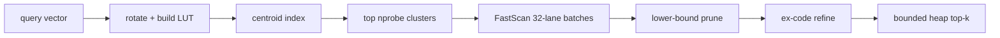
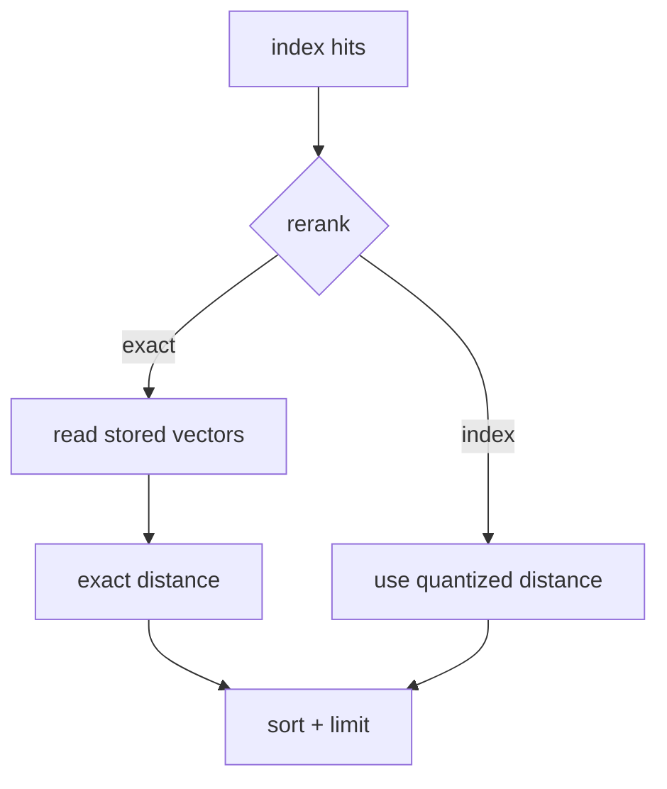

# Concepts

## Namespace / Table

LakeSoul 的 namespace 对应 PostgreSQL 元数据里的逻辑分组；**表**是数据与索引的边界。

一个表包含：

- 一组数据文件；
- 分区/主键/schema 元数据；
- 可选的 `vector_index_columns` 表属性；
- 每个向量列的 `_vector_index/...` 索引文件。

查询时指定 `namespace.table`，例如 `"lakesoul"."default"."docs"`。

## Row / Primary Key

LakeSoul 的“document”就是一行数据，主键是 `primary_keys` 声明的列。

- 向量索引的 key 是主键的 arrow-Row 编码；
- Upsert 由 merge-on-read 处理；
- 索引只决定候选主键，最终行内容由数据层决定。

## Vector Column

向量列必须是 `float32`（也支持 `float16`/`float64` 的部分路径）的**定长列表**：

```python
pa.field("embedding", pa.list_(pa.field("item", pa.float32()), 768), nullable=False)
```

索引声明：

```json
{"column": "embedding", "dim": 768, "nlist": 256, "total_bits": 7, "metric": "L2"}
```

## Index Shard

索引按 `(partition_desc, hash_bucket_id)` 分片：

- 每个 shard 有自己的 IVF centroids 和 segment；
- 查询时只加载/探测相关 shard；
- 分区裁剪和 hash bucket 决定要访问哪些 shard。

## IVF / nprobe



IVF 把向量聚成 `nlist` 个 cluster，查询时只探测最近的 `nprobe` 个 cluster。

- `nlist` 越大，cluster 越细，构建越慢；
- `nprobe` 越大，召回越高、延迟越高；
- 两者共同决定召回和 QPS。

## RaBitQ / total_bits

RaBitQ 是量化索引：

- `total_bits=1`：只存 1 bit/维，索引小、召回低；
- `total_bits=7`：索引更大、召回更高；
- exact 模式会对候选做精确重排；index-only 直接用索引距离。

## Exact vs Index-only



| 模式 | 排序依据 | 是否读向量列 | 特点 |
|---|---|---|---|
| `rerank="exact"` | 候选行的原始向量 | 是 | 更准确，成本更高 |
| `rerank="index"` | 索引量化距离 | 否 | 更快，近似 |

## Recall

ANN 不保证 100% 召回。影响 recall 的因素：

- `nprobe`；
- `total_bits`；
- `nlist` 与数据分布；
- `top_k` / `exact_overfetch`；
- 过滤条件和数据更新频率。

## Upsert / Delete

- 数据层 merge-on-read 保证最新行；
- 索引层用 mutation mask 隐藏旧副本；
- `delete_by_primary_keys` 写索引 tombstone，但**不删除数据行**；
- 重建索引会重新读取数据文件，已删除的行不会回来；只删索引 tombstone 而数据行还在时，重建会重新索引。

## Cache

- **L1 内存**：已解析索引、lazy cluster、snapshot、decoded block；
- **L2 SSD**：通用 DiskCache、可选 IndexSsdCache；
- **L3 对象存储**：source of truth。

详见 [Warm Cache](warm-cache.md)。

## Snapshot / Time Travel

- 向量索引描述的是**当前最新文件**；
- 时间旅行查询会跳过索引，做精确扫描；
- 删除索引不影响历史快照的数据正确性。

下一篇：[Performance](performance.md)。
