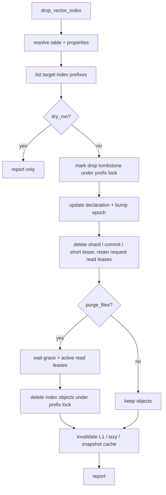

# 删除向量索引（drop_vector_index）

> **本文档是 drop 向量索引的唯一使用文档。**
> API、参数、返回字段、tombstone/epoch/状态机/异步 GC 语义变化时，必须同步更新本文档。

## 1. 语义

`drop_vector_index` 删除**派生索引**，不删除表数据：

- 不修改 Parquet 数据文件；
- 不修改分区、schema、数据 commit、CDC 墓碑、快照；
- 删除 `index_shard / index_commit / index_lease`；
- 已运行的原生batch请求使用独立 `index_read_lease` 固定索引commit和原始文件，逻辑drop不会级联删除这些读租约；
- 删除 `_vector_index/...` 对象（`purge_files=True` 时）；物理清理等待活跃读租约释放或过期；
- 默认从 `vector_index_columns` 移除声明；
- 递增表属性 `vector_index_epoch`；
- 清理本进程 L1 index / lazy shard / snapshot 缓存；
- `keep_declaration=True` 时把 `vector_index_available` 置为 `false`，
  planner 自动回退普通扫描；`rebuild` / `declare` 会重新置为 `true`。

索引删除后，普通单向量查询可自动回退扫描，数据仍然可读。新的原生SQL batch入口要求可用索引，drop后会明确拒绝；已经固定快照并取得读租约的batch可继续读取原commit。

读租约默认TTL120秒、30秒续租。`wait_for_cleanup=True` 除了等待grace，还等待活跃读者结束，因此可能超过grace_seconds；需要立即返回时使用 `wait_for_cleanup=False`。续租失败使batch取消，不允许失去保护后继续输出。显式重建与物理清理通过同一prefix锁协调，清理发现原drop已被重建取代时拒绝删除新对象。



## 2. Python API

```python
table.drop_vector_index(
    column="embedding",          # None = 所有声明列
    partition_desc=None,         # 只删一个分区
    partitions=None,             # 分区映射简写
    keep_declaration=False,      # 默认移除声明
    purge_files=True,            # 是否删除对象文件
    dry_run=False,
    if_exists=True,
    grace_seconds=0.0,           # 对象删除保护期
    wait_for_cleanup=True,       # False = 后台清理，立即返回
)
```

返回：

```python
{
    "table_name": "docs",
    "namespace": "default",
    "columns": ["embedding"],
    "partitions": ["-5"],
    "shards_dropped": 4,
    "objects_deleted": 1024,
    "bytes_deleted": 162010176,
    "declaration_removed": True,
    "dry_run": False,
    "epoch": 3,
    "drop_id": "c1b8...",
    "cleanup": "tombstone_retained",
}
```

`cleanup`：

| 值 | 含义 |
|---|---|
| `completed` | 对象清理完成，声明保留 |
| `tombstone_retained` | 对象清理完成，声明已移除，tombstone 保留 |
| `deferred` | 控制面已删除，后台任务继续清理对象 |

### 2.1 分区级删除

```python
table.drop_vector_index(
    column="embedding",
    partition_desc="dt=2024-01-01",
    keep_declaration=True,  # 分区级删除强制保留声明
)
```

只删目标分区的 shard；其他分区索引和声明保留。

### 2.2 删除后重建

默认删除会移除声明，但仍可重建：

```python
table.recreate_vector_index(
    column="embedding",
    dim=768,
    nlist=1024,
    total_bits=7,
    metric="L2",
    rotator_type="FhtKac",
)
```

等价显式步骤：

```python
table.declare_vector_index([{
    "column": "embedding",
    "dim": 768,
    "nlist": 1024,
    "total_bits": 7,
    "metric": "L2",
    "rotator_type": "FhtKac",
}])
table.rebuild_vector_index(column="embedding")
```

- `declare_vector_index` 写回 `vector_index_columns` 并清除该列的 drop tombstone；
- `recreate_vector_index` = declare + rebuild；
- 重建从数据文件重新训练 IVF，不依赖旧索引对象。

### 2.3 删除但保留声明

```python
table.drop_vector_index(column="embedding", keep_declaration=True)
table.rebuild_vector_index(column="embedding")
```

后续写入也可以按声明自动重建。

### 2.4 Catalog 入口

```python
catalog.drop_vector_index("docs", column="embedding", keep_declaration=True)
```

## 3. Rust / DataFusion API

```rust
use lakesoul_datafusion::vector_index::{
    DropVectorIndexOptions, drop_vector_index,
};

let report = drop_vector_index(
    &client,
    "docs",
    "default",
    &object_store_options,
    DropVectorIndexOptions {
        columns: Some(vec!["embedding".into()]),
        keep_declaration: false,
        purge_files: true,
        grace: std::time::Duration::from_secs(300),
        wait_for_cleanup: true,
        ..Default::default()
    },
).await?;
```

`LakeSoulTable::drop_vector_index(options)` 是 Rust 表级封装。

## 4. SQL 入口

SQL 使用标量 DDL 函数：

```sql
SELECT lakesoul_drop_vector_index(
    'docs', 'default', 'embedding',
    false,   -- keep_declaration
    true,    -- purge_files
    0.0,     -- grace seconds
    true,    -- wait_for_cleanup
    false    -- dry_run
);
```

返回一行 JSON 字符串。

破坏性调用需要：

```bash
export LAKESOUL_ALLOW_INDEX_DDL=1
```

未设置时只允许 `dry_run=true`。SQL 入口仍受 PostgreSQL 连接本身权限限制。

## 5. tombstone

`index_drop` 保存每个被删 prefix 的删除标记：

```text
(kind='vector', index_prefix='.../_vector_index/embedding/-5/0')
```

作用：

- `ensure_shard` 看到 tombstone 返回 `IndexDropped`；
- `commit_vector_build` 看到 tombstone 直接 no-op；
- 旧 writer 不会把索引重新建回来；
- 数据写入不会因为索引 drop 失败。

`keep_declaration=False` 时 tombstone 保留，直到：

- `declare_vector_index` / `recreate_vector_index`；
- 显式 `rebuild_vector_index()`；
- `drop_table` 级联清理。

`gc_dropped_vector_index_objects()` 只删除对象，不清 tombstone。

## 6. epoch 与缓存

每次 drop / re-declare 会递增表属性：

```text
vector_index_epoch = N + 1
```

| 缓存 | 失效方式 |
|---|---|
| 本进程 metadata cache | drop/declare 后立即失效 |
| snapshot cache | key 包含 epoch，旧 plan 不再命中 |
| L1 index cache | drop 时按 prefix 失效 |
| lazy shard cache | drop 时按 prefix 失效 |
| 其他节点 | 下次刷新 table_info 后看到新 epoch |

跨节点可见性受 `LAKESOUL_METADATA_TTL_MS` 限制；需要强一致时不要开启或设置很小。

## 7. 状态机与异步清理

`index_drop` 行包含 `drop_id / state / updated_at`：

```text
tombstoned
  → control_plane_deleted
  → objects_pending
  → tombstone_retained / completed
  → objects_failed（可 GC 重试）
```

`wait_for_cleanup=False`：

- 控制面立即删除；
- 返回 `cleanup="deferred"` 和 `drop_id`；
- 后台任务在 `grace_seconds` 后删除对象；
- 进程退出时状态保留，可调用 GC 继续清理。

`wait_for_cleanup=True` 时，调用方等待对象清理完成。

## 8. GC

```python
table.gc_dropped_vector_index_objects()
```

返回：

```python
{
    "tombstones": 4,
    "objects_deleted": 0,
    "bytes_deleted": 0,
}
```

行为：

- 删除 tombstone prefix 下的对象；
- 保留 tombstone（防止旧 writer）；
- 将状态推进到 `tombstone_retained`；
- 可重复执行，幂等。

## 9. drop_table

`drop_table` 会级联清理：

- `index_shard / index_commit / index_lease`
- `index_drop` tombstone

避免同一路径重建表继承旧索引控制面。对象目录仍由表目录清理/维护任务处理。

## 10. 限制

- 重建依赖表数据；已经 `drop_table` 的表不能重建原索引。
- 多节点强一致仍受 `LAKESOUL_METADATA_TTL_MS` 和本地 snapshot cache 影响。
- `drop_table` 不删除对象文件，只清控制面。
- SQL 是标量函数，不是 `ALTER TABLE ... DROP VECTOR INDEX`。
- 目前没有独立后台 maintenance 进程；deferred 清理依赖进程存活或手动 GC。
- Python API 使用进程自身的 PG/S3 凭据，不额外检查 table owner；
  SQL 入口额外受 `LAKESOUL_ALLOW_INDEX_DDL` 控制。
