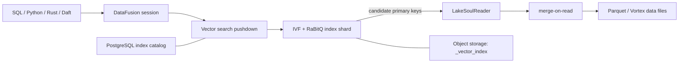

# Introduction

LakeSoul 的向量检索不是独立的向量数据库，而是**湖仓表上的二级索引**：

```text
LakeSoul table
  ├─ 数据文件（Parquet / Vortex）
  ├─ 表元数据（PostgreSQL）
  └─ 向量索引（对象存储上的 _vector_index/）
```

查询时，向量索引只负责“召回哪些主键”，最终行内容仍由 LakeSoul 的数据层
（merge-on-read、CDC 删除墓碑、分区裁剪、快照）决定。



## 能力

- **ANN 检索**：IVF + RaBitQ，支持 L2 / InnerProduct；
- **SQL / DataFrame 接口**：DataFusion SQL、Python `table.search`、Daft；
- **增量索引**：写入后自动构建/更新，不重写历史 segment；
- **Upsert / Delete 可见性**：同一主键只返回最新副本；
- **过滤**：分区裁剪、主键/属性过滤与 ANN 结合；
- **两种排序**：
  - `rerank='exact'`：索引召回候选，再用原始向量精确重排；
  - `rerank='index'`：直接按索引量化距离排序，不读向量列；
- **批量查询**：一次调用多个 query，复用同一份索引/快照；
- **缓存分级**：L1 内存索引/块缓存 + L2 本地 SSD + 对象存储；
- **pgvector 兼容服务**：`postgres-lakesoul` 提供 pgvector 风格 SQL。

## 设计目标

1. 在 LakeSoul 表上做 ANN top-k，而不是引入独立系统；
2. 索引与数据解耦：数据文件仍是普通列式文件，索引是旁路对象；
3. 支持增量写入、分区、hash bucket、并行构建；
4. 与 merge-on-read / CDC / 快照语义一致；
5. 对象存储友好：不可变文件 + catalog commit + reader lease + GC；
6. 索引可补建、可重建、可删除，删除不影响数据正确性。

## 非目标

- 不做通用向量数据库；
- 不做跨表全局 ANN；
- 不做 GPU 检索；
- 不保证 100% 召回（ANN 是近似索引）；
- 当前不支持 `cosine_distance` 的索引下推（可先归一化，或走精确扫描）。

## 取舍

| 取舍 | 说明 |
|---|---|
| 索引是异步构建的 | 写入成功后可能短暂“未覆盖”，查询会精确扫描未覆盖文件 |
| ANN 有召回损失 | `nprobe` / `total_bits` 影响 recall；exact 只在候选集内重排 |
| 删除索引会回退全扫 | 结果正确但变慢，见 [Write](write.md) |
| 缓存是进程内的 | 多节点/多进程不共享缓存，见 [Warm Cache](warm-cache.md) |
| SQL 形态有限制 | 只识别 `ORDER BY array_distance/inner_product LIMIT` 等模式 |

## 和传统向量数据库的差异

| 维度 | LakeSoul | 专用向量数据库 |
|---|---|---|
| 数据模型 | 湖仓表 + 主键 + 分区 | collection / namespace + document |
| 一致性 | 表快照 + merge-on-read | 各自的事务/一致性模型 |
| 索引 | 表上的二级索引 | 系统核心 |
| 删除索引 | 删索引，数据不受影响 | 通常删 collection/namespace |
| 多引擎 | Spark/Flink/DataFusion/Python | 通常专用 SDK |

下一篇：[Quickstart](quickstart.md)。
