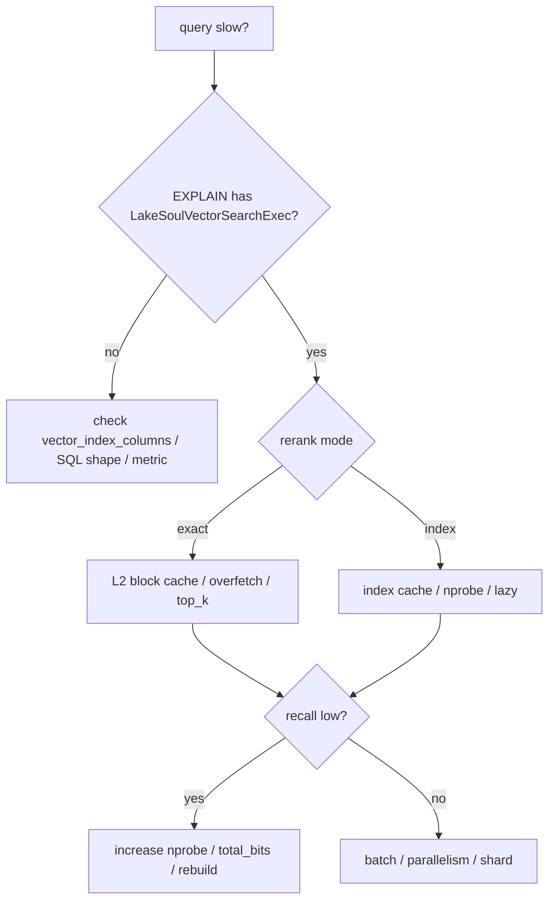

# Performance

向量检索的性能主要由三类因素决定：

1. **索引参数**：`nlist`、`total_bits`、`nprobe`、`top_k`；
2. **查询形态**：exact / index-only、过滤、批量；
3. **缓存状态**：冷查询 / 热查询、L1/L2 命中。



## 1. 索引参数

| 参数 | 影响 | 建议 |
|---|---|---|
| `nlist` | cluster 数；越大越细，构建越慢 | 每 bucket 约 `sqrt(rows)`；10 万 ~256–512，100 万 ~1024–4096 |
| `total_bits` | 量化位数；越大索引越大、召回越高 | 7 为常用默认；1 适合极致省空间/低召回 |
| `metric` | L2 / IP | 与查询函数一致；cosine 需归一化 |
| `hash_bucket_num` | 并行度；每 bucket 一个 shard | 大表 4–16；小表 1–2 |

## 2. 查询参数

| 参数 | 影响 |
|---|---|
| `nprobe` | 探测 cluster 数；越大召回越高、延迟越高 |
| `top_k` | 返回条数 |
| `exact_overfetch` | exact 模式下每 bucket 候选倍数 |
| `rerank` | `exact` 更准更慢；`index` 更快但近似 |
| `parallelism` | 并行探测的 cluster 组数 |
| `filter` | 过滤条件；分区裁剪可减少文件 |

## 3. Cold vs Warm

- **冷查询**：索引不在 L1/L2，需要从对象存储加载 segment / 块；
- **热查询**：命中 L1 index cache / lazy cluster / snapshot / decoded block；
- 第一次 exact 查询还会构建 decoded block 缓存。

缓存配置见 [Warm Cache](warm-cache.md)。

## 4. exact 与 index-only

| 模式 | 优点 | 缺点 |
|---|---|---|
| `exact` | 候选内精确排序，recall 更稳 | 读候选向量、成本更高 |
| `index` | 不读向量列，延迟低 | 量化距离，边界结果可能不同 |

经验：

- 对召回要求高、数据量不大：`exact`；
- 对 QPS/延迟敏感、可接受近似：`index`；
- 先用 `index` 评估召回，再用 `exact` 校准。

## 5. 批量查询

| 入口 | 说明 |
|---|---|
| DataFusion SQL loop | 每个 query 一条 SQL，顺序执行，重复 planning |
| `LakeSoulSession.batch_search` | 一次调用多个 query，`batch_size` 控制 |
| `LakeSoulTable.search_batch` | Python 入口，内部走 native snapshot batch |
| pgvector SQL loop | PG wire 单连接顺序执行 |

### 5.1 index-only batch

GloVe-200、1,183,514 行、4 bucket、nlist=1024、bits=1、top_k=100、
nprobe=16、200 query、MinIO 本地：

| 入口 | QPS | RSS |
|---|---:|---:|
| DataFusion SQL loop | 412.0 | 303.5 MB |
| DataFusion native batch | 5,934.7 | 293.9 MB |
| Python `search_batch` | 6,522.4 | 286.9 MB |
| pgvector SQL loop | 634.2 | 258.3 MB（服务端） |

不同轮次缓存状态不同，量级一致；index-only 始终是最高吞吐。

### 5.2 exact batch

exact 需要读候选向量；native batch 200 query、warm 3 轮：

| 模式 | 首 batch | warm QPS | RSS | 本地 block |
|---|---:|---:|---:|---:|
| block 256，L2=1GiB | 2131 ms | 386.6 | 858.7 MB | 917.6 MB |
| block 256，L2 仅 256MiB | 8153 ms | 9.4 | 973.1 MB | 258.9 MB |

结论：

- exact 首 batch 包含候选块解码/写缓存；
- L2 预算必须覆盖工作集，过小会频繁淘汰；
- batch exact 会同时触达大量 block，高吞吐优先 index-only。

### 5.3 多文件 bucket 的 exact batch

native exact 支持一个 bucket 多文件，但必须满足覆盖性证明：

- 当前 index commit 覆盖快照全部文件；
- 无 mutation chain、无 CDC 列；
- 单 `Int64` 主键 `id`；
- 每个文件有 `birth_version` rank；
- 固定长度 `Float32` 向量列。

满足时：

```text
每个文件 → VectorBlockSource
候选 key 按 rank 解析到最新 (file, row)
按文件分组读 block
跨 bucket 精确打分/合并
```

单文件 bucket 仍走原来的 fast path。不满足时回退逐 query SQL exact，
结果正确但更慢。普通增量写入后直接跑 native exact 往往仍会回退；
需要先做一次完整 `rebuild_vector_index()`。

### 5.4 cluster-lazy 实测

Deep-Image 10M、nlist=1024、bits=1、nprobe=16、NQ=100：

| 模式 | eager | cluster-lazy | 变化 |
|---|---:|---:|---:|
| index 单查询 | 2.50 QPS / 1933 ms | 65.6 QPS / 274 ms | 26× |
| index batch | 120.4 QPS / 430 ms | 699.2 QPS / 142 ms | 5.8× |
| exact 单查询 | 1.90 QPS / 1536 ms | 9.72 QPS / 1118 ms | 5.1× |
| exact batch | 92.4 QPS / 697 ms | 291.3 QPS / 396 ms | 3.2× |

## 6. 数据布局

- **每 bucket 单文件**：native batch 快速路径更友好；
- **多文件 bucket**：仍可查，但可能走 SQL 回退；
- **大导入**：先 `auto_build_vector_index=False` 分批写，最后 `build_vector_index()`；
- **增量更新多**：定期 `rebuild_vector_index()` 重置 centroid 和 mutation 链。

## 7. 缓存预算

| 变量 | 作用 |
|---|---|
| `LAKESOUL_VECTOR_MEMORY_BYTES` | L1 总预算 |
| `LAKESOUL_CACHE_PATH` / `LAKESOUL_CACHE_SIZE` | L2 通用缓存 |
| `LAKESOUL_INDEX_SSD_BYTES` | 索引文件专用缓存（可选） |
| `LAKESOUL_VECTOR_LAZY_INDEX` | 大索引只加载 probe cluster |

经验：

- exact 工作集大时，L2 必须覆盖候选 block 工作集；
- index-only 更依赖 L1/L2 索引文件缓存；
- 多节点部署时缓存不共享，需按副本数分别配置。

缓存层级、exact decoded-block、IndexSsdCache 的细节见 [Warm Cache](warm-cache.md)。

## 8. 性能排障

| 现象 | 可能原因 | 处理 |
|---|---|---|
| 查询慢、计划无 `LakeSoulVectorSearchExec` | 未下推/索引未声明 | 检查 `EXPLAIN`、`vector_index_columns` |
| exact 很慢 | L2 未配置/很小 | 配置 `LAKESOUL_CACHE_PATH/SIZE` |
| index-only 冷启动慢 | 索引不在 L2 | 配置 `LAKESOUL_INDEX_SSD_BYTES` |
| 召回低 | `nprobe`/`total_bits` 小 | 调大参数或重建 |
| 写入慢 | 每小批都触发索引构建 | 关闭 auto build，批量后补建 |

更多实测和调优见 [README.md](README.md) 与 [usage.md](usage.md)。

下一篇：[API Overview](api-overview.md)。
