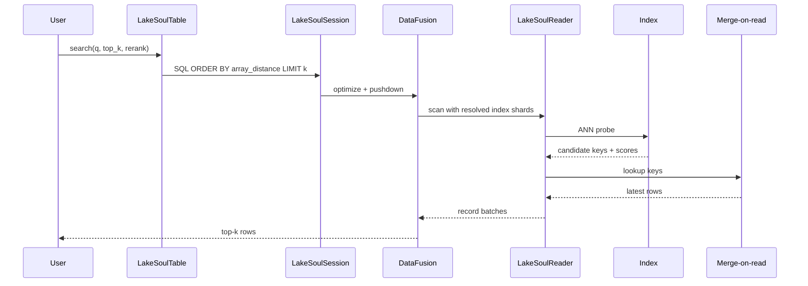

# Query

LakeSoul 支持两种查询入口：Python `table.search` 和 SQL。

## 1. Python `table.search`

```python
result = table.search(
    q,                 # 查询向量
    top_k=10,
    column="embedding",# 多列时必填
    metric="L2",       # L2 / IP
    rerank="exact",    # exact / index / auto
    nprobe=64,
    exact_overfetch=10,
    filter="lang = 'zh'",
    columns=["id", "title"],
    with_distance=True,
    session=session,
)
```

### rerank

| 值 | 行为 |
|---|---|
| `exact` | 索引召回候选，再读原始向量精确重排 |
| `index` | 直接按索引量化距离排序，不读向量列 |
| `auto` | 由实现选择 |

### filter

- 分区过滤会裁剪文件；
- 普通属性过滤在候选/扫描阶段执行；
- 复杂过滤可能降低索引效果，建议先用 `EXPLAIN` 确认。

### with_distance

在结果中增加 `__lakesoul_vector_distance`：

- exact：精确距离；
- index：量化距离。



## 2. SQL

```sql
SET lakesoul_vector_search.nprobe = 64;
SET lakesoul_vector_search.rerank = 'exact';
SET lakesoul_vector_search.exact_overfetch = 10;

SELECT id, title,
       array_distance(embedding, ARRAY[1,0,0,0]) AS distance
FROM "lakesoul"."default"."docs"
ORDER BY array_distance(embedding, ARRAY[1,0,0,0])
LIMIT 10;
```

内积：

```sql
SELECT id
FROM "lakesoul"."default"."docs"
ORDER BY inner_product(embedding, ARRAY[1,0,0,0]) DESC
LIMIT 10;
```

多列加权：

```sql
SELECT id
FROM "lakesoul"."default"."docs"
ORDER BY 0.7 * array_distance(text_vec, ARRAY[...])
       + 0.3 * array_distance(image_vec, ARRAY[...])
LIMIT 10;
```

## 3. 批量查询

```python
batch = table.search_batch(
    [q1, q2, q3],
    top_k=10,
    rerank="index",
    nprobe=64,
    session=session,
)
print(batch.ids)
```

完整可运行示例见 [Python原生批量Notebook](../tutorial/native_python_batch.ipynb)，覆盖直接 `session.batch_search`、表级入口、L2/IP、index/exact、ID/排名结构、基线校验与清理。表级入口会为不支持的表保留SQL兼容回退；需要直接使用原生入口并暴露错误时调用 `session.batch_search`。

优点：

- 一次加载 shard；
- 多个 query 复用同一份索引/快照；
- 适合离线评估、批量召回。

DataFusion 与 LakeSoul pgwire 也可用一条 SQL 执行原生批量查询：

```sql
SELECT query_id, rank, id, distance
FROM lakesoul_vector_search_batch_from_table(
  'lakesoul.default.docs', 'embedding',
  'lakesoul.default.query_vectors', 'qid', 'qvec',
  10, 64, 'L2', 'index'
)
ORDER BY query_id, rank;
```

pgwire 中使用当前数据库的 `public.docs` 和 `public.query_vectors`。这是有界并行的native batch算子，复用快照、cluster和FastScan block；不是逐条SQL循环。新SQL入口目前要求Int64主键 `id`、完整索引覆盖、无CDC/mutation chain，不满足时明确报错。参数、输入校验、资源预算与实际可运行示例见 [Native SQL Batch](../native-batch-sql.md) 和 [Notebook](../tutorial/native_batch_sql.ipynb)。

## 4. 结果顺序

- L2：距离升序；
- IP：内积降序；
- `top_k` 是全局 top-k（跨 bucket 合并后）；
- 距离相同不保证 tie 顺序。

## 5. 下推检查

```python
plan = session.explain(sql)
print("LakeSoulVectorSearchExec" in plan)
```

如果计划中没有该节点：

- 表没有声明 `vector_index_columns`；
- SQL 形状不匹配（例如 `cosine_distance`、非 top-k 查询）；
- 索引不可用/被删除；
- metric/列类型不匹配。

## 6. 回退普通扫描

索引被删除、未构建或不可用时，查询可以回退普通扫描：

- 结果仍然正确；
- 慢很多；
- exact/index-only 的差异消失，改为精确排序。

详见上文“回退普通扫描”。

## 7. 常见查询错误

| 现象 | 原因 |
|---|---|
| `no vector_index_columns property` | 表未声明索引，或 drop 时移除了声明 |
| `query dimension mismatch` | 查询向量长度与 `dim` 不符 |
| 计划无 `LakeSoulVectorSearchExec` | SQL 形状/索引/权限问题 |
| 结果少于 `top_k` | 过滤后候选不足，或 ANN 召回不足 |

下一篇：[Warm Cache](warm-cache.md)。
