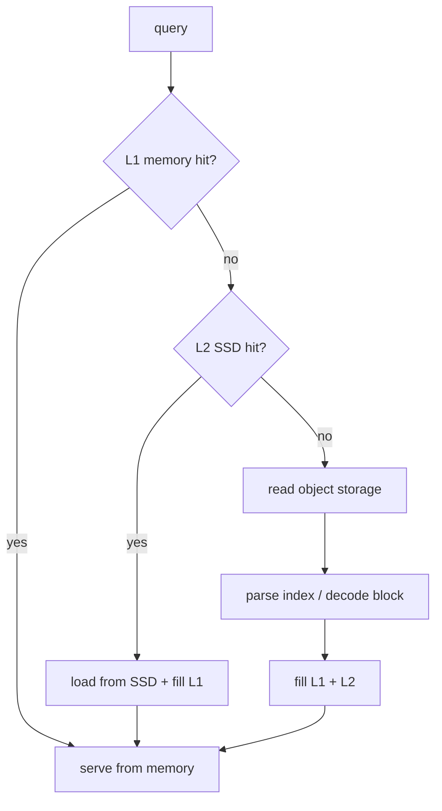
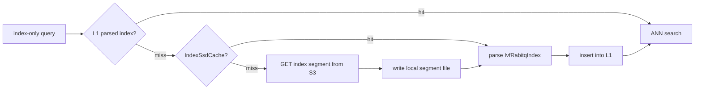
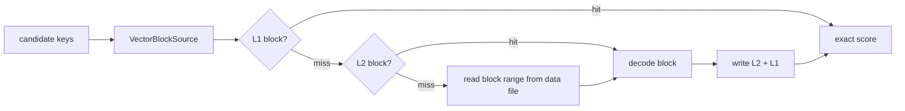

# Warm Cache

LakeSoul 的向量缓存是**进程内**的，分为三层：

```text
L1 Memory
  ├─ 已解析索引（eager index cache）
  ├─ lazy cluster（只加载 probe 的 cluster）
  ├─ snapshot（DataFusion 查询快照）
  └─ decoded block（exact 候选块）

L2 Local SSD
  ├─ 通用 DiskCache（数据页 / PK key index / decoded block）
  └─ IndexSsdCache（索引 segment / mutation 文件，可选、可持久化）

L3 Object Storage
  └─ 数据文件 + _vector_index/...
```



L1/L2 只影响速度，对象存储是 source of truth。缓存键现在包含实际 `ObjectStore` 的分配身份；不同 bucket/endpoint 的同名路径不会复用 PK locator、decoded block、parsed vector shard 或 index SSD 内容。cache entry保留store引用以防指针复用。

通用store接口无法可靠提供持久后端身份，因此本实现为disk key增加进程nonce：服务重启后不盲目复用旧后端的同路径缓存。IndexSsdCache首次访问会扫描其专属目录中格式正确的16位十六进制`.bin`条目，按mtime和当前预算采用/淘汰旧条目，避免每次重启累积在LRU之外；未知文件、符号链接和活动临时下载文件不删除。预算按缓存实例/进程管理，不是多个进程共享一个目录时的全局硬配额；部署可为进程分配独立cache目录。

## 1. 配置

| 变量 | 默认 | 作用 |
|---|---|---|
| `LAKESOUL_VECTOR_CACHE` | 开 | 向量缓存总开关；`0` 关闭 L1/L2，index-only 变慢，exact 回退 reader |
| `LAKESOUL_VECTOR_MEMORY_BYTES` | 512 MiB | L1 总预算，内部按 cluster/snapshot/block 分配 |
| `LAKESOUL_CACHE_PATH` | `lakesoul_cache_dir` | L2 根目录，数据页、PK index、decoded block 共用 |
| `LAKESOUL_CACHE_SIZE` | 1 GiB（L2 启用时） | 通用 DiskCache 容量；`0` 关闭 L2 |
| `LAKESOUL_INDEX_SSD_BYTES` | 0 | 索引文件专用缓存；显式设置后启用，独立于通用 L2 预算 |
| `LAKESOUL_INDEX_SSD_DIR` | 按实现默认 | `IndexSsdCache` 目录 |
| `LAKESOUL_VECTOR_LAZY_INDEX` | auto | cluster 数 ≥64 时只加载 probe 的 cluster；`0` 强制 eager |

L1 内部预算大致是：

```text
LAKESOUL_VECTOR_MEMORY_BYTES
  ├─ directory / snapshot   固定小预算
  ├─ cluster cache          ~60%
  ├─ decoded block cache    ~30%（exact 活跃时）
  └─ query / Arrow          剩余
```

必须在 `import lakesoul` 之前设置环境变量。

```bash
export LAKESOUL_VECTOR_CACHE=1
export LAKESOUL_VECTOR_MEMORY_BYTES=8GiB
export LAKESOUL_CACHE_PATH=/data/lakesoul/cache
export LAKESOUL_CACHE_SIZE=100GiB
export LAKESOUL_VECTOR_LAZY_INDEX=auto

# 可选：索引文件独立持久缓存
export LAKESOUL_INDEX_SSD_BYTES=20GiB
export LAKESOUL_INDEX_SSD_DIR=/data/lakesoul/index-cache
```

兼容/专家变量（`LAKESOUL_INDEX_MEMORY_BYTES`、`LAKESOUL_VECTOR_BLOCK_CACHE_BYTES`
等）仍可能工作，但不建议新部署使用；以公共变量为准。

## 2. index-only 路径：S3 → SSD → Memory

index-only（`rerank='index'`）只需要索引，不读向量列。



### 2.1 L1：已解析索引

- `lakesoul-io/src/index/cache.rs` 的进程级 moka 加权 LRU；
- key 含 `(kind, index_prefix, commit_id)`；
- commit 变化自动失效；
- 并发同 key 使用 singleflight，避免重复加载；
- 超预算的 entry 不缓存，直接再次加载。

### 2.2 L2：IndexSsdCache

`IndexSsdCache` 缓存**整个索引文件**（segment / mutation），不是 16 KiB 页：

- moka 加权 LRU，按容量淘汰并删除本地文件；
- 下载到 `.tmp` → `sync_all` → `rename`，不会读到半写文件；
- 跨进程重启保留；启动时惰性注册，首次命中才打开文件；
- 通过 `IndexCachedStore` 包装 object store，只对索引加载生效；
- HEAD/条件 GET 直接委托，避免为了元数据下载整文件；
- 预算独立：`LAKESOUL_INDEX_SSD_BYTES`，默认关闭，不挤占通用页缓存。

### 2.3 失效

索引文件不可变；commit 变化会生成新文件/新 key，因此：

- L1 按 commit 失效；
- L2 旧文件由 LRU 淘汰，不需要原地更新；
- drop index 时会清理本进程 L1/lazy/snapshot 缓存。

### 2.4 参考实测

200,000 × 128d f32、4 bucket、nlist=256、bits=1、top_k=10、nprobe=16、
200 query、MinIO 本地、1024 个 segment（约 16 MiB）：

| 场景 | 首查 | QPS | RSS |
|---|---:|---:|---:|
| SSD 关闭，索引从 MinIO 读 | 103.8 ms | 562.9 | 278.0 MB |
| SSD 首次填充 | 504.5 ms | 557.8 | 280.9 MB |
| SSD 命中，且 S3 上索引对象已删除 | 174.6 ms | 533.4 | 278.6 MB |

第三行说明 L2 确实在服务：S3 索引对象已删除，查询仍成功。
本机 MinIO 延迟远低于真实 S3，真实环境下 SSD 对首查/tail 的收益会更明显。

## 3. exact 路径：按需 decoded-block

exact（`rerank='exact'`）需要候选行的原始 f32/f64 向量。

LakeSoul **不生成整文件 payload**，而是按 block 解码候选行：

```text
exact query
  → ANN 候选 key
  → VectorBlockSource（每个 data file / 向量列一个）
       ├─ L1：moka block cache
       ├─ L2：DiskCache（与数据页/PK index 共享）
       └─ miss：按 block 行范围读取
                 Vortex take / Parquet row selection
                 → 解码 raw f32/f64
                 → 写 L2 + L1
```



### 3.1 block 定义

- 目标 block 约 256 KiB，按 `LAKESOUL_VECTOR_MEMORY_BYTES` 自动选择行数；
- 200d f32 时约 `256 × 200 × 4 = 200 KiB`；
- key 为 `(source_hash, field_hash, block_id)`；
- 内容为该 block 内所有向量行，row-major little-endian；
- 只支持固定长度向量列（`FixedSizeList`）；变长/复杂类型回退 reader。

### 3.2 生命周期

| 对象 | 生命周期 |
|---|---|
| L1 block | 进程内 moka LRU，进程退出释放 |
| L2 block | 通用 `DiskCache`，容量淘汰，重启按需重建 |
| S3 payload | 不存在 |
| 整文件 payload | 已移除 |

### 3.3 参考实测

GloVe 1,183,514 × 200d、4 bucket、nlist=1024、bits=1、top_k=100、nprobe=16、
of=1、200 query、MinIO 本地：

| 模式 | 首查 | QPS | RSS | 本地 block |
|---|---:|---:|---:|---:|
| block 256，L2=1GiB | 791.9 ms | 70.0 | 873.4 MB | ~917.6 MB |
| 重复热查询 | — | 83.7 / 107.3 / 107.9 | — | — |
| block 256，L2 仅 256MiB | 1592.9 ms | 9.4 | 973.1 MB | 258.9 MB |

native batch exact（200 query 一次调用，warm 3 轮）：

| 模式 | 首 batch | warm QPS | RSS |
|---|---:|---:|---:|
| index-only | 1219 ms | 11,424.7 | 292.6 MB |
| block 256，L2=1GiB | 2131 ms | 386.6 | 858.7 MB |

结论：

- 首查只构建候选 block，不预写整列；
- 随机 query 最终仍会触达大量 block，L2 必须覆盖工作集；
- 热点查询可到 84–108 QPS；
- batch 高吞吐优先 index-only，exact 受向量读取/解码限制。

### 3.4 cluster-lazy

Deep-Image 10M、nlist=1024、bits=1、nprobe=16、NQ=100：

| 模式 | eager | cluster-lazy |
|---|---:|---:|
| exact 单查询 | 1.90 QPS / RSS 2026 MB | 9.72 QPS / RSS 1808 MB |
| exact batch | 92.4 QPS / RSS 2894 MB | 291.3 QPS / RSS 2481 MB |

cluster-lazy 只加载 probe 的 cluster，exact 仍使用 decoded block，但不再为每个
query 重载完整 index。

### 3.5 多文件 bucket

exact native batch 支持一个 bucket 下多个数据文件，但要求覆盖性证明：

- 当前 index commit 覆盖快照全部文件；
- 无 mutation chain、无 CDC 列；
- 单 `Int64` 主键 `id`；
- 每个文件有 `birth_version` rank；
- 固定长度 `Float32` 向量列。

不满足时回退逐 query SQL exact；结果仍然正确，只是慢。

## 4. 预热与多进程

LakeSoul 没有托管服务式的 warm cache hint / pinning API，可以：

```python
# 轻量预热：让索引/块进入 L1/L2
table.search(q, top_k=1, rerank="index", session=session)
```

或让服务启动后先跑一次 baseline 查询。

多进程/多节点：

- 每个进程独立缓存，不共享；
- `IndexSsdCache` 目录可共享，文件不可变 + 原子 rename，多进程安全；
- 容量统计是每进程近似，不做跨进程硬配额。

## 5. 已知限制

1. **L2 需要覆盖工作集**：过小会频繁淘汰，exact 吞吐骤降。
2. **启动惰性注册**：重启后首个查询仍有文件打开/解析成本。
3. **无内容校验**：依赖索引文件不可变 + segment CRC；本地文件损坏时当前不会自动删除重拉。
4. **小文件过多**：1024 个小 segment 的冷启动打开成本不可忽略。
5. **指标**：L1/L2 有进程内 hits/misses/evictions，尚未接入 Prometheus。
6. **exact 无整文件 payload**：不要再用旧 `LAKESOUL_VECTOR_RERANK_CACHE*` 配置。

## 6. 常见问题

| 现象 | 原因 | 处理 |
|---|---|---|
| 首次查询慢 | 索引/块未缓存 | 预热、配置 IndexSsd |
| 重启后 index-only 慢 | 索引不在 L2 | 开启 `LAKESOUL_INDEX_SSD_BYTES` |
| exact 反复慢 | L2 太小或未配置 | 增大 `LAKESOUL_CACHE_SIZE` |
| exact 回退 reader | 没有 L2 或缓存关闭 | 开启 `LAKESOUL_CACHE_SIZE` |
| 缓存配置不生效 | import 之后才设置 env | 重启 kernel/进程，在 import 前设置 |
| IndexSsd 不生效 | 只设置 `LAKESOUL_CACHE_SIZE` | 显式设置 `LAKESOUL_INDEX_SSD_BYTES` |

## 7. 清理

```bash
rm -rf "$LAKESOUL_CACHE_PATH"
rm -rf "$LAKESOUL_INDEX_SSD_DIR"
```

通用 DiskCache、decoded block、PK index 在 `LAKESOUL_CACHE_PATH`；
索引文件在 `LAKESOUL_INDEX_SSD_DIR`。没有独立 payload 目录。

## 8. 代码位置

| 模块 | 位置 |
|---|---|
| L1 索引缓存 | `rust/lakesoul-io/src/index/cache.rs` |
| lazy cluster | `rust/lakesoul-vector/src/rabitq/ivf/lazy.rs` |
| L2 通用 DiskCache | `rust/lakesoul-io/src/cache/` |
| IndexSsdCache | `rust/lakesoul-io/src/index/ssd_cache.rs` |
| decoded block | exact 路径的 `VectorBlockSource` |
| 查询集成 | `rust/lakesoul-io/src/vector/search.rs` |

下一篇：[Roadmap & Changelog](roadmap-and-changelog.md)。
