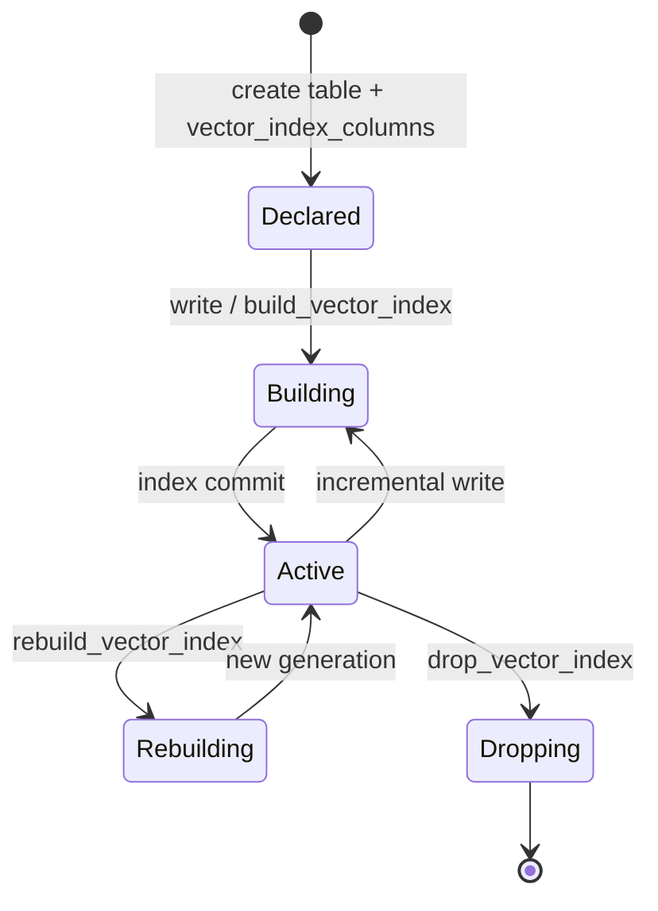
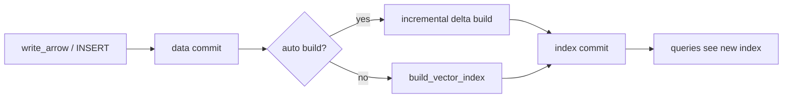

# Write

LakeSoul 的写入遵循“数据提交 + 索引异步维护”的模型：

```text
write data → data commit → auto_build_vector_index → index commit
```

数据文件和索引文件都不可变；更新通过追加 + merge-on-read 完成。



## 1. 建表时声明索引

```python
table = catalog.create_table(
    "docs",
    path="s3://bucket/docs",
    schema=schema,
    primary_keys=["id"],
    hash_bucket_num=4,
    vector_index=[{
        "column": "embedding",
        "dim": 768,
        "nlist": 1024,
        "total_bits": 7,
        "metric": "L2",
    }],
)
```

声明会保存到表属性 `vector_index_columns`。



## 2. 日常写入：自动增量构建

```python
table.write_arrow(rows)  # 提交数据，并自动增量更新索引
```

- 只索引本次写入的新文件；
- 不重写历史 segment；
- 未覆盖文件由查询做精确扫描；
- 每次小批写入都触发构建，频繁小批可能变慢。

## 3. 大批量导入：先写数据，最后补建

```python
for batch in batches:
    table.write_arrow(batch, auto_build_vector_index=False)

table.build_vector_index()  # 一次性补建历史数据
```

适合：

- 从其他引擎导入历史数据；
- 分批写入、最后统一建索引；
- 避免每批都触发 k-means / 量化。

## 4. 重建索引

```python
table.rebuild_vector_index()
table.rebuild_vector_index(column="embedding")
table.rebuild_vector_index(partition_desc="dt=2024-01-01")
```

重建会：

- 从全部 active 数据文件重新训练 centroids；
- 发布新的 index generation；
- 清空 mutation 链；
- 旧 generation 由 GC 回收。

适用场景：

- 数据分布漂移；
- 调整 `nlist` / `total_bits` / `metric`；
- 增量索引太大，需要整理。

## 5. SQL 写入

```sql
INSERT INTO "lakesoul"."default"."docs" VALUES
  (1, 'cat', ARRAY[1,0,0,0]),
  (2, 'kitten', ARRAY[0.9,0.1,0,0]);

INSERT OR REPLACE INTO "lakesoul"."default"."docs" VALUES
  (1, 'cat v2', ARRAY[1,0,0,0]);
```

提交后自动维护索引（取决于表属性和 `index_maintenance` 配置）。

## 6. 删除数据 vs 删除索引

| 操作 | 影响 |
|---|---|
| SQL `DELETE` / `write_arrow` 删除行 | 数据层 merge-on-read 处理；索引需要 tombstone 或 rebuild |
| `delete_by_primary_keys` | 写索引 tombstone，不删除数据行 |
| `table.drop_vector_index()` | 删除索引（可选移除声明），不删除数据行 |
| `catalog.drop_table()` | 删除表，不保证同步清理索引对象 |

详见上文“删除数据 vs 删除索引”。

## 7. 索引生命周期

| 场景 | 操作 |
|---|---|
| 日常写入 | 自动增量构建 |
| 历史数据首次建索引 | `build_vector_index()` |
| 改参数/漂移 | `rebuild_vector_index()` |
| 不再需要索引 | `drop_vector_index()` |
| 删除表 | `drop_table()` + 清理 S3 |

## 8. 写入性能建议

- 大批量写入：关闭 auto build，最后统一补建；
- 小批频繁写入：接受索引维护开销，或延迟构建；
- 每 bucket 尽量少文件，利于 native batch；
- 大表使用 4–16 个 hash bucket 并行构建；
- 写入期间查询会精确扫描未覆盖文件，可能变慢。

下一篇：[Query](query.md)。
