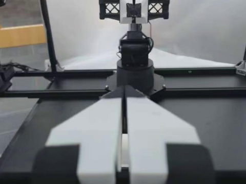

This example reads an existing **Prepared table**: it shows the state, the action and four camera
images at one time step, then calls the LakeSoul API to build one training window. Prepared has
already been quality-filtered and split into train/val/test, and carries `split` and
`valid_interval_id`; this example does not re-run QC, does not write any table and does not train a
model.

The images use the per-frame JPEG layout (not GOP tables). Run the four cells below in a Notebook
environment configured with LakeSoul PG and S3 credentials, then save the outputs. Dependencies:
`lakesoul[daft]`, `pillow`, `numpy`, `ipykernel`.

The runnable notebook lives at
[`python/examples/embodied/aloha/aloha_prepared_quickstart.ipynb`](https://github.com/lakesoul-io/LakeSoul/blob/main/python/examples/embodied/aloha/aloha_prepared_quickstart.ipynb).

## 1. Connect to an existing Prepared table

Change the table name to reuse a previous run. `EPISODE_ID` picks the trajectory to look at;
connection parameters come from the environment and are not shown in the output.

```python
import os
from io import BytesIO

import numpy as np
import pyarrow.dataset as ds
from PIL import Image
from IPython.display import display
from lakesoul import LakeSoulCatalog
from lakesoul.embodied.daft import read_samples

TABLE = "aloha_velcro_prepared_4cam_ann"  # 改成你的 Prepared 表名
NAMESPACE = "default"
EPISODE_ID = "ep000000"
CAMERAS = ["cam_high", "cam_low", "cam_left_wrist", "cam_right_wrist"]

catalog = LakeSoulCatalog.from_env(
    namespace=NAMESPACE,
    object_store_options={
        "fs.s3a.endpoint": os.environ["AWS_ENDPOINT"],
        "fs.s3a.access.key": os.environ["AWS_ACCESS_KEY_ID"],
        "fs.s3a.secret.key": os.environ["AWS_SECRET_ACCESS_KEY"],
        "fs.s3a.path.style.access": "true",
    },
)
table = catalog.table(TABLE)
print(f"Prepared 表：{NAMESPACE}.{TABLE}")
```

```text
Prepared 表：default.aloha_velcro_prepared_4cam_ann
```

## 2. Read the first retained row of one trajectory

Sort by the original frame number and keep one row for display. Filtered-out frames are absent from
Prepared, so the first row is not necessarily frame 0.

```python
episode_scan = table.scan().filter(ds.field("episode_id") == EPISODE_ID)
rows = (
    episode_scan.to_daft()
    .sort("frame_index")
    .limit(1)
    .to_arrow()
    .to_pylist()
)
if not rows:
    raise ValueError(f"Prepared 中没有轨迹 {EPISODE_ID}")
row = rows[0]

print("episode:", row["episode_id"])
print("frame_index:", row["frame_index"])
print("timestamp:", round(row["timestamp"], 4), "s")
print("split:", row["split"])
print("valid_interval_id:", row["valid_interval_id"])
print("state:", np.round(row["observation_state"], 3))
print("action:", np.round(row["action"], 3))
```

```text
episode: ep000000
frame_index: 0
timestamp: 0.0 s
split: train
valid_interval_id: ep000000/0:700
state: [ 0.    -0.965  1.177 -0.002 -0.293 -0.002 -0.055 -0.006 -0.963  1.173
  0.002 -0.291  0.002 -0.044]
action: [ 0.006 -0.948  1.166 -0.002 -0.308  0.011 -0.098 -0.006 -0.956  1.155
  0.002 -0.304  0.    -0.117]
```

## 3. View the four camera images of the same step

Decode the JPEG bytes into static images. All four come from the same row; only the display size is
reduced, the bytes stored in the table are untouched. Static images survive a notebook export into
documentation.

```python
for camera in CAMERAS:
    print(f"{camera} | frame {row['frame_index']}")
    with Image.open(BytesIO(row[camera])) as image:
        preview = image.convert("RGB")
        preview.thumbnail((480, 360))
        display(preview)
```

| cam_high · frame 0 | cam_low · frame 0 |
| :---: | :---: |
|  |  |
| **cam_left_wrist · frame 0** | **cam_right_wrist · frame 0** |
|  |  |

## 4. Build one training sample from a contiguous valid interval

Only the interval containing the row above is read. The observation length is 10, the action length
is 10 and the stride is 5. For an anchor at t, the observation covers t−9 to t and the action covers
t to t+9. Window offsets are half-open; windows that do not fit are skipped.

Prepared intervals already guarantee contiguous original frames. Grouping by `valid_interval_id`
here avoids crossing excluded frames and never re-assigns the train/val/test split. Real training
should draw from the train split and evaluate on the matching val/test split.

```python
interval_scan = table.scan().filter(
    (ds.field("valid_interval_id") == row["valid_interval_id"])
    & (ds.field("split") == row["split"])
)
windows = read_samples(
    interval_scan,
    episode_column="valid_interval_id",
    order_by="frame_index",
    window={
        "observation_state": (-9, 1),
        **{camera: (-9, 1) for camera in CAMERAS},
        "action": (0, 10),
    },
    stride=5,
    boundary="skip",
)
samples = windows.sort("anchor").limit(1).to_arrow().to_pylist()
if not samples:
    raise ValueError("当前区间不足以构造完整窗口，请选择另一条轨迹或调整窗口长度")
sample = samples[0]
t = sample["anchor"]

print("episode:", EPISODE_ID, "| split:", row["split"])
print("valid_interval_id:", sample["valid_interval_id"])
print(f"anchor: {t} | 观察帧: [{t - 9}, {t + 1}) | 动作帧: [{t}, {t + 10})")
print("state shape:", np.asarray(sample["observation_state"]).shape)
print("action shape:", np.asarray(sample["action"]).shape)
for camera in CAMERAS:
    print(f"{camera}: {len(sample[camera])} 张 JPEG 图片")
```

```text
episode: ep000000 | split: train
valid_interval_id: ep000000/0:700
anchor: 10 | 观察帧: [1, 11) | 动作帧: [10, 20)
state shape: (10, 14)
action shape: (10, 14)
cam_high: 10 张 JPEG 图片
cam_low: 10 张 JPEG 图片
cam_left_wrist: 10 张 JPEG 图片
cam_right_wrist: 10 张 JPEG 图片
```

The result is one multimodal training sample: a state sequence, four JPEG sequences and an action
target sequence. It has not been normalized or stacked into a Tensor batch.
