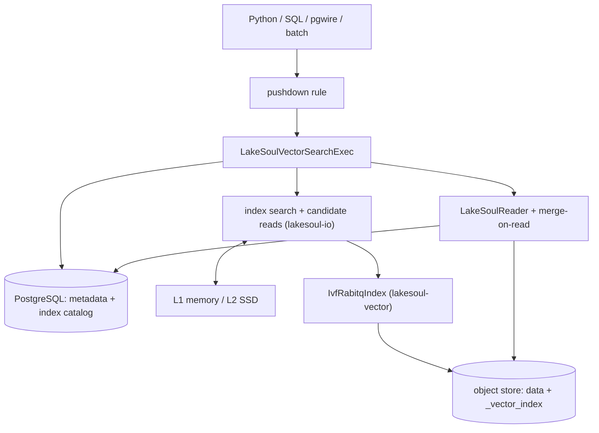

# Vector search architecture and caching

<!--
SPDX-FileCopyrightText: 2026 LakeSoul Contributors

SPDX-License-Identifier: Apache-2.0
-->

LakeSoul vector search is a secondary index on a lakehouse table, not a separate
vector database: it stores candidate primary keys as `arrow-row` bytes and rows
are read from the table's files through merge-on-read. This page covers the
layers, data model, index structure, query execution and — in most detail — the
three-tier cache.

## 1. Layers and data flow



| Layer | Component | Responsibility |
| --- | --- | --- |
| Access | Python/Daft, DataFusion SQL, `postgres-lakesoul`, batch functions | Parse the call, return rows |
| Planning | Pushdown rule, `LakeSoulVectorSearchExec` | Recognise top-k, resolve shards, plan the scan |
| Index IO | `lakesoul-io` | Builder, index search, candidate reads, caches |
| Index core | `lakesoul-vector` | IVF/RaBitQ, segments/mutations, commit model |
| Control plane | `lakesoul-metadata` | Catalog rows, reader leases, GC |
| Storage | object store + PostgreSQL | Immutable objects, transactional metadata |

Dependencies are one-way: `lakesoul-vector` does not depend on `lakesoul-io`;
the shard builder lives in `lakesoul-io` because it reads table data; DataFusion
and the Python bindings sit on top. A query resolves the shards for one
snapshot, probes them for candidates, deduplicates by version, reads rows (PK
locator or `pk IN`), and optionally re-ranks exactly before `LIMIT`.

## 2. Data model and object layout

### 2.1 Tables, partitions, hash buckets and shards

One **shard** per `(partition_desc, hash_bucket_id)`:

```text
table
├── partition A, bucket 0   → one shard
├── partition A, bucket 1   → one shard
└── partition B, bucket 0   → one shard
```

`partition_desc` is the partition directory relative to the table root (`-5`
for unpartitioned tables); `hash_bucket_id` comes from the data file name and
`hash_bucket_num`. Each shard has its own centroids, commit history, candidate
budget and rebuild/GC lifecycle, mirroring write sharding: builds run in
parallel and one shard can be rebuilt or dropped independently.

### 2.2 Objects under `_vector_index/`

```text
{table_path}/_vector_index/{vector_column}/{partition_desc}/{bucket_id}/
├── cluster_0000_0000_<rand>.seg   # base segment of cluster 0
├── cluster_0000_0001_<rand>.seg   # delta segment of cluster 0
└── _mutations/g{generation:08}/
    ├── <txid>.delta               # LSMD: updated/deleted keys + revision
    └── <txid>.checkpoint          # LSMC: merged (key, revision) table
```

- Everything is **immutable**; random suffixes keep concurrent builders from
  overwriting each other.
- A **segment** is a `SEG2` file with one cluster's centroid, quantized codes
  and key bytes. The serialized header (`RBQH`, carrying `key_kind`) lives in
  the catalog.
- A **mutation sidecar** records updates/deletes without rewriting segments: a
  delta is a sorted key set plus a revision and a parent link; a checkpoint
  merges them into a `(key, revision)` table and bounds the chain.
- Catalog segment entries record covered data files (`data_files`) and
  `birth_version`, so readers find files the index does not cover yet.

### 2.3 Index catalog (PostgreSQL)

| Table | Holds | Notes |
| --- | --- | --- |
| `index_shard` | One row per `(kind, index_prefix)` | `unique (kind, index_prefix)` |
| `index_commit` | `generation`, `version`, `header`, cumulative `segments`, mutation head/records, `superseded_at` | `unique (shard_id, generation, version)`; resolve reads the newest row |
| `index_lease` / `index_read_lease` | Reader leases: short loads / request-level batch reads | Keep segments alive during load; batch leases pin the commit and data file paths (no FK) |
| `index_drop` | Drop tombstones and cleanup state | Blocks a stale writer from recreating a dropped shard |

Each commit row carries the **cumulative** segment list of its generation, so a
shard resolves with one lookup. Old rows are kept for readers of earlier
commits and removed by GC after the grace period.

### 2.4 `IndexKey`: primary keys as `arrow-row` bytes

Each vector is keyed by the `arrow-row` encoding of the table's primary-key
columns — the same layout the PK locator uses, so results are looked up without
decoding. Single and composite keys are supported and the encoding is
order-preserving. The header's `key_kind` fingerprint is compared with the
table schema; if it changed, the index is not used and the query scans
exactly.

### 2.5 Commit protocol

```text
1. write immutable segment / mutation objects (random suffixes)
2. catalog commit with compare-and-swap: expected = (generation, version);
   insert a new index_commit row with the cumulative segment list
3. on conflict: re-resolve, rewrite the sidecar at the new revision
   (segments are never rewritten), retry a bounded number of times
```

A delete-only commit carries no segments, only a sidecar; a rebuild starts a new
`generation` at `version = 1` and clears the mutation chain. The unique
`(shard_id, generation, version)` constraint is the CAS primitive.

A `generation` is one incarnation of a shard's index (bumped only by rebuild); a
`version` is the commit revision within a generation and is comparable across
clusters. `segment_version` is a cluster-local delta counter, while
`birth_version` is the global catalog revision at which a segment was published
— the newest copy of a key wins on `birth_version`.

## 3. Index structure and maintenance

### 3.1 IVF clusters

Each shard has `nlist` centroid clusters trained by k-means; a query selects
the `nprobe` nearest (L2: smallest distance, inner product: largest dot) and
probes only those. `nlist` is clamped to the vector count.

### 3.2 RaBitQ and FastScan

Each vector stores a 1-bit code per dimension, an **ex-code** of
`total_bits - 1` bits, factors and residual statistics. The query is randomly
rotated and a LUT turns 1-bit codes into accumulations. Vectors are packed in
**32-vector batches**, so FastScan estimates distances with SIMD, prunes by a
lower bound, decodes survivors with the ex-code and pushes them into a bounded
top-k heap. With `ex_bits = 0`, refinement is skipped.

### 3.3 Base and delta segments

The base segment of a cluster (`segment_version = 0`) holds its centroid and
the vectors present at build time. Every incremental write appends **delta
segments** with only the new vectors; existing segments are never rewritten. A
query merges base and deltas, applies the mutation mask before distance
computation, and scans a cluster's tail of fewer than 32 pending vectors
individually.

### 3.4 Build modes

| Mode | Reads | Writes | Result |
| --- | --- | --- | --- |
| Fresh | All active files of the shard | Base segments per cluster | Generation 1, version 1 |
| Incremental | Newly committed files only | One delta per touched cluster | Same generation, `version + 1` |
| Rebuild | All active files of the shard | Fresh base segments (new k-means) | New generation, version 1, mutation chain cleared |

A fresh build is two-pass and bounded-memory: pass 1 streams shard vectors into
a reservoir for k-means, pass 2 streams them for quantization; raw vectors are
never materialized as one array. Incremental builds load base centroids,
quantize new vectors into deltas and deduplicate keys.

The rebuild policy is per shard: `rebuild_mode = "auto"` (default) rebuilds the
shard when **any** cluster has `delta_vectors / base_vectors >
max_delta_ratio` (default `1.0`); per-cluster detection reacts earlier to
concentrated drift and does not fire on uniform growth. `"none"` only appends
deltas. Native-engine writers apply the policy after commits; Python-SDK writes
append deltas and use an explicit rebuild. A table with
`index_maintenance = 'deferred'` commits data only and builds pending shards
later.

### 3.5 Lazy cluster loading

A query probes only `nprobe` of `nlist` clusters, so loading all payloads
eagerly is wasteful for very large shards. In lazy mode the index keeps only
the centroid selector and loads a cluster payload on first probe into a
byte-budgeted LRU; concurrent misses share one cancellation-aware load.
`LAKESOUL_VECTOR_LAZY_INDEX=auto` (default) enables it for large shards (at
least 64 clusters and either a ~1 GiB index or ≥2 million vectors); `1` forces
lazy, `0` forces eager. Small shards keep the eager cache, which has lower
per-query overhead; exact re-rank still reads candidates through the block
path below.

## 4. Query execution

Entry points are DataFusion SQL (`ORDER BY array_distance(...) LIMIT k` becomes
a candidate scan), Python `table.search`/`search_batch` (the same SQL shape on
an in-process session), the pgwire endpoint (pgvector operators and
`SET ivfflat.probes`), the native batch table functions, and the low-level
`table.scan().options(reader_options=...)` candidate API.

### 4.1 Resolving shards and leases

Planning resolves active files to index prefixes and reads one catalog view per
shard (commit, generation, version, header, segments, mutation head). The reader
receives resolved shards and performs no metadata queries. A lease is taken only
when the shard is not cached, covering the load window; a cache hit needs none.
Long batch requests pin a request-level lease instead (section 6).

### 4.2 Index-only vs exact

| Mode | Ordering | Vector-column reads | Distance |
| --- | --- | --- | --- |
| `rerank="index"` (default) | Quantized index distance | None | Index estimate |
| `rerank="exact"` | Candidates re-ranked on stored vectors | Candidate rows only | Exact L2/IP |

In exact SQL plans the exec node returns candidates and the `Sort` above
computes the exact top-k; index-only plans remove that sort because the node
orders by the reserved distance column. Exact mode overfetches candidates
(`top_k × exact_overfetch`, default 10).

### 4.3 Coverage and deduplication

The index is maintained after the data commit, so a reader may see files no
segment covers yet: it computes `pending = active files − covered files`,
exact-scans them and marks their candidates `birth_version = u64::MAX` so they
win deduplication. Candidates for one request are merged by `IndexKey`; when a
key appears in several clusters, segments or uncovered files, the copy with the
highest `birth_version` wins and its score is ranked. The catalog revision is
global, so this is correct across clusters.

### 4.4 Row reads

Candidates are keys, not rows. Two strategies fetch rows:

- **PK locator (preferred).** Each data file gets a sorted, mmap'ed key index
  using the same `arrow-row` encoding, kept in the shared disk cache and reused
  because files are immutable. A lookup binary-searches it, converts keys to
  row ranges and fetches only those rows (Vortex row indices / Parquet row
  selection). A candidate budget bounds it; it falls back when exactness is not
  provable.
- **`pk IN (...)` pushdown (fallback).** Keys become per-column filters in the
  scans; composite keys use a superset and merge-on-read restores exactness.

Rows then go through **merge-on-read**, which keeps the newest version per key
and drops CDC deletes; an index hit is only a candidate, and the merge decides
the row. Exact re-rank is two-phase: phase 1 ranks on key and vector columns and
keeps what `LIMIT` can return; phase 2 fetches those rows' payloads. A filter
above the scan disables phase 2 because it can change which rows the limit
returns.

### 4.5 Multiple columns and native batch

Multi-column queries search each declared column independently, **intersect**
the candidates and rank by the weighted sum of distances; columns must share the
metric, and index-only fusion is L2-only. The native batch entry pins one
snapshot, one set of index reads and one request lease, then processes queries in
**bounded windows** (default 256 queries, bounded parallelism, IO concurrency
and transient memory). Results stream as `(query_id, rank, id, distance)` and
are unordered; the entry requires a single `Int64` key named `id`, exact index
coverage and no CDC/mutation chain, and otherwise rejects the request.

### 4.6 Fallbacks

When correctness cannot be proven, the query runs an exact scan (slower but
correct): missing index, `key_kind` mismatch, exact-only metric, or unknown shape.

## 5. Caching

All caches are **per process**: they reduce latency, and the object store is the
source of truth.

```text
L1 process memory : parsed index, lazy clusters, snapshots, decoded blocks
L2 local SSD      : shared DiskCache + optional whole-file index cache
L3 object store   : data files + _vector_index/...  (source of truth)
```

### 5.1 L1: process memory

**Eager parsed index cache.** A process-wide `moka` weighted LRU keyed by
`(index kind, store identity, index prefix)`; each entry records the catalog
`commit_id` and is reused only when it matches, so a commit or rebuild
invalidates the shard next query. Concurrent misses share one load; an
oversized entry is served once and not retained. Store identity derives from the
store's configuration, not the handle, so SQL and native readers share an entry;
other endpoints get a duplicate, never a wrong one.

**Lazy cluster cache.** For lazy shards, payloads live in a byte-budgeted LRU
keyed by store identity, prefix, commit id and cluster id; loads are
single-flight and cancellation-aware, and payloads/mutation masks are `Arc`
views, never copied.

**Snapshot cache.** The provider/executor caches the resolved shard list of a
query snapshot, so repeated statements skip the catalog lookup. At most two
snapshots are kept within the snapshot budget; the key includes table/index
prefixes, `vector_index_epoch`, store identity and the file set. Entries pin
index shards the eager cache may evict, hence the separate budget; a metadata
refresh or dropped index invalidates them.

**Decoded block cache.** Exact re-rank reads only candidate rows' vectors. The
per-file/column `VectorBlockSource` decodes fixed-size blocks into a `moka`
weighted LRU keyed by `(source_hash, field_hash, block_id)` (file + namespace,
column layout, ordinal). Blocks are raw little-endian rows sized by a ~256 KiB
target with rows from the L1 budget (clamped 32–1024; expert override
available). Only fixed-size list columns take this path.

**Block sources and file handles.** Up to 16 opened block sources and 1024
opened Vortex files are kept to amortize footer/row planning
(`LAKESOUL_VECTOR_BLOCK_SOURCE_CACHE=0` disables the former).

### 5.2 L1 budget

`LAKESOUL_VECTOR_MEMORY_BYTES` sets the L1 budget (default 512 MiB);
`LAKESOUL_VECTOR_CACHE=0` disables the vector caches. With a unified budget:

| Share | Unified | Legacy default |
| --- | --- | --- |
| Cluster cache (eager index + lazy payloads) | 60% | 512 MiB |
| Snapshot cache | 10% (clamped 64–512 MiB) | 512 MiB |
| Decoded-block cache | 30% | 256 MiB |

`LAKESOUL_VECTOR_BLOCK_CACHE_BYTES` overrides the block share (the others have
expert overrides too). Values are read at first cache use, so set them before
starting the process or importing the SDK.

### 5.3 L2: shared DiskCache

The vector L2 is the shared LakeSoul read-through disk cache, not a vector-only
cache. Reads are stored in file-aligned **4 MiB pages** (`LAKESOUL_CACHE_PAGE_BYTES`),
so two reads share an entry exactly when they touch the same pages. Capacity and
path are `LAKESOUL_CACHE_SIZE` (default 1 GiB when enabled) and
`LAKESOUL_CACHE_PATH` (default `lakesoul_cache_dir`). It holds table data pages,
PK locator key indexes and decoded blocks; decoded blocks are block-sized
entries, not 4 MiB pages, but share the capacity and LRU. It is the generic
LakeSoul cache, enabled with `LAKESOUL_CACHE`, reused instead of a second disk
cache.

Capacity is enforced per process with weighted LRU eviction (not a global quota);
keys carry the object-store identity token, so endpoints never share entries.

### 5.4 L2: optional index segment cache

The eager cache only helps while a parsed shard fits in memory. The optional
`IndexSsdCache` keeps **whole immutable index files** (segments, mutation
sidecars) on local disk, so a cold process pays a local read plus parse instead
of an object-store fetch:

- `LAKESOUL_INDEX_SSD_BYTES` — byte budget; `0`/unset disables it (an expert
  override).
- `LAKESOUL_INDEX_SSD_DIR` — directory, default
  `<LAKESOUL_CACHE_PATH>/index-cache` (or a temporary `lakesoul-index-cache`);
  `LAKESOUL_INDEX_SSD_KIND` names the namespace (default `index-v1`).

Entries are downloaded to a temporary file, `fsync`-ed and atomically renamed,
so readers never see half-written files; eviction unlinks the file after
in-flight readers release it; capacity is a `moka` weighted LRU over whole
files. After a restart the cache lazily scans its directory and adopts
format-valid entries for eviction bookkeeping (mtime approximates recency),
trimming it to the budget. It is installed only for index loading; writes and
listings delegate to the inner store and HEAD/conditional GETs are delegated.
Its budget is independent of L2.

### 5.5 L3 object store and the read-through bypass

The object store is authoritative; L1/L2 only reduce latency. Two vector IO
paths deliberately avoid the generic page cache:

- **Index segment reads.** The vector index directory is a **bypass path** in
  the read-through cache: reads under `_vector_index/` go straight to the inner
  object store. Index files are immutable and read once per cold shard, so
  page-caching them adds a HEAD and a page-sized write for no reuse and churns
  the shared L2 with small-object reads.
- **Exact candidate reads.** The block source issues many small one-shot range
  reads per query and takes the **raw inner store** instead of the read-through
  wrapper, avoiding per-read bookkeeping. Decoded blocks are admitted to L1 and
  to the shared disk cache as block-sized entries.

Non-vector data keeps the read-through page cache; vector search does not fill
the shared L2 with 4 MiB data pages or evict table pages through it.

### 5.6 Lifetime and invalidation

| Event | L1 | L2 |
| --- | --- | --- |
| Cache instance recreated in one process | Rebuilt; L2 hits still work (store token stable within the process) | Serves entries written earlier by the same process |
| Process restart | Empty | **No reuse.** Disk keys carry a process nonce, so vector L2 entries do not hit, including the index segment cache; the persistent index directory is lazily scanned for bookkeeping and refetched |
| Delta commit or rebuild | Eager entry mismatches `commit_id` and reloads; lazy shards/snapshots are keyed by commit/epoch | Immutable files are keyed by path: new commits reference new files (fetched on demand); old files age out by LRU |
| `drop_vector_index` | Eager index, lazy shards, snapshots and PK-locator entries for the prefix are invalidated; `vector_index_epoch` is bumped | Objects are deleted after the drop's grace period |

Caches are process-local: processes do not share hits and capacity is per
process; both tiers evict by LRU under memory pressure, and an entry larger than
the whole budget is never retained. The index segment directory is safe to share
(immutable files, atomic rename) but does not create cross-process hits; give
each process its own directory when capacity should be per process.

## 6. Concurrency, consistency and garbage collection

**Commit concurrency.** The unique `(shard_id, generation, version)` constraint
serializes commits per shard: a writer validates its expected version and
inserts a row in one transaction; a loser gets a conflict, rewrites its sidecar
and retries. Randomly named immutable segments mean a loser's segment is only
an orphan, collected later.

**Read consistency.** A query reads one catalog view per shard and one snapshot
and does not re-resolve during execution, so results match that snapshot under
merge-on-read. Cross-node visibility is immediate except for optional
`LAKESOUL_METADATA_TTL_MS` memoization.

**Read leases.** Short `index_lease` rows (TTL
`LAKESOUL_VECTOR_INDEX_LEASE_TTL_SECS`, default 300 s) cover index loads not
served by the process cache. Native batch requests use `index_read_lease` rows
(TTL 120 s, renewed every 30 s) pinning the index commit and data file paths;
losing the lease cancels the request.

**Drop and tombstones.** A drop is a logical delete followed by physical
cleanup. The prefix gets an `index_drop` tombstone so a stale writer's
build/commit becomes a no-op; `vector_index_epoch` is bumped and local caches
invalidated. Cleanup waits for the grace period and active leases, then walks
`tombstoned → control_plane_deleted → objects_pending → tombstone_retained`
(or `objects_failed`, retried by GC). The tombstone remains until a rebuild or
declaration re-creates the index.

**Garbage collection.** `gc_vector_index` keeps the latest `keep_generations`
(default 1) generations, deletes commit rows superseded for longer than
`grace_seconds` (default 3600), and removes unreferenced segments and eliminated
generations' sidecars. The write path amortizes a shard GC every
`LAKESOUL_INDEX_GC_EVERY` writes (default 16) when grace is non-zero.

## 7. Design trade-offs

- **IVF + RaBitQ** — compact codes, SIMD FastScan, bounded streaming build and
  simpler persistence than a graph index; approximate distances need a re-rank.
- **Sidecar index** — formats stay unchanged, any engine can read/write, and the
  index is rebuildable/droppable; the cost is the catalog/commit protocol.
- **Shard per `(partition, bucket)`** — parallel build/search and independent
  rebuild/GC; the cost is more catalog rows and small-segment cold opens.
- **Append-only segments + mutation sidecars** — writes never rewrite history and
  deletes avoid read-modify-write; old copies need masking and rebuild compacts.
- **Quantized order by default** — avoids reading candidate vector columns on
  the common path; recall is bounded by index accuracy and exact costs reads.
- **`arrow-row` keys** — match table ordering, support composite keys and let
  the PK locator reuse the layout; a primary-key schema change invalidates the
  index.
- **Per-process caches** — no external cache service or network hop; there is no
  cross-process sharing and L2 is rebuilt after a restart.

## Next

[Configuration](configuration.md) for index parameters and cache variables,
[API reference](api.md) for the query surface, and
[benchmarks](benchmarks.md) for measured recall and throughput.
