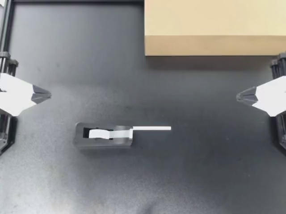
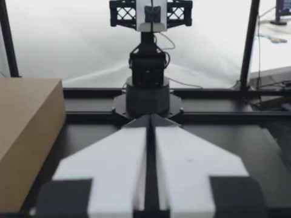

本示例读取已有的 **Prepared 表**：展示一个时间步的状态、动作和四路相机图片，再调用 LakeSoul API 构造一个训练窗口。Prepared 已完成质量筛选与数据集划分，包含 `split` 和 `valid_interval_id`；本示例不重新执行 QC、不写表、不训练模型。

使用逐帧 JPEG 图片布局（不是 GOP 表）。在配置好 LakeSoul PG 和 S3 环境变量的 Notebook 环境中依次运行下面四个单元格，然后保存输出。依赖：`lakesoul[daft]`、`pillow`、`numpy`、`ipykernel`。

完整的可运行 Notebook 见 [`python/examples/embodied/aloha/aloha_prepared_quickstart.ipynb`](https://github.com/lakesoul-io/LakeSoul/blob/main/python/examples/embodied/aloha/aloha_prepared_quickstart.ipynb)。

## 1. 连接已有 Prepared 表

修改表名即可使用之前生成的结果。`EPISODE_ID` 指定要查看的轨迹；连接参数从环境读取，不在输出中展示。

```python
import os
from io import BytesIO

import numpy as np
import pyarrow.dataset as ds
from PIL import Image
from IPython.display import display
from lakesoul import LakeSoulCatalog
from lakesoul.embodied.daft import read_samples

TABLE = "aloha_velcro_prepared_4cam_ann"  # 改成你的 Prepared 表名
NAMESPACE = "default"
EPISODE_ID = "ep000000"
CAMERAS = ["cam_high", "cam_low", "cam_left_wrist", "cam_right_wrist"]

catalog = LakeSoulCatalog.from_env(
    namespace=NAMESPACE,
    object_store_options={
        "fs.s3a.endpoint": os.environ["AWS_ENDPOINT"],
        "fs.s3a.access.key": os.environ["AWS_ACCESS_KEY_ID"],
        "fs.s3a.secret.key": os.environ["AWS_SECRET_ACCESS_KEY"],
        "fs.s3a.path.style.access": "true",
    },
)
table = catalog.table(TABLE)
print(f"Prepared 表：{NAMESPACE}.{TABLE}")
```

```text
Prepared 表：default.aloha_velcro_prepared_4cam_ann
```

## 2. 查询一条轨迹的第一条保留记录

按原始帧号排序，只取一行用于展示。被筛掉的帧不会出现在 Prepared 中，因此第一条记录不一定是第 0 帧。

```python
episode_scan = table.scan().filter(ds.field("episode_id") == EPISODE_ID)
rows = (
    episode_scan.to_daft()
    .sort("frame_index")
    .limit(1)
    .to_arrow()
    .to_pylist()
)
if not rows:
    raise ValueError(f"Prepared 中没有轨迹 {EPISODE_ID}")
row = rows[0]

print("episode:", row["episode_id"])
print("frame_index:", row["frame_index"])
print("timestamp:", round(row["timestamp"], 4), "s")
print("split:", row["split"])
print("valid_interval_id:", row["valid_interval_id"])
print("state:", np.round(row["observation_state"], 3))
print("action:", np.round(row["action"], 3))
```

```text
episode: ep000000
frame_index: 0
timestamp: 0.0 s
split: train
valid_interval_id: ep000000/0:700
state: [ 0.    -0.965  1.177 -0.002 -0.293 -0.002 -0.055 -0.006 -0.963  1.173
  0.002 -0.291  0.002 -0.044]
action: [ 0.006 -0.948  1.166 -0.002 -0.308  0.011 -0.098 -0.006 -0.956  1.155
  0.002 -0.304  0.    -0.117]
```

## 3. 查看同一时刻的四路相机图片

将 JPEG 字节解码为静态图片。四张图片来自同一条记录；仅缩小显示尺寸，不修改表内图像。静态图片可以随 Notebook 输出导出到文档。

```python
for camera in CAMERAS:
    print(f"{camera} | frame {row['frame_index']}")
    with Image.open(BytesIO(row[camera])) as image:
        preview = image.convert("RGB")
        preview.thumbnail((480, 360))
        display(preview)
```

| cam_high · frame 0 | cam_low · frame 0 |
| :---: | :---: |
|  |  |
| **cam_left_wrist · frame 0** | **cam_right_wrist · frame 0** |
|  |  |

## 4. 按连续有效区间构造一个训练样本

只读取上述记录所在的区间，观察长度为 10，动作长度为 10，步长为 5。锚点为 t 时，观察取 t−9 至 t，动作取 t 至 t+9。窗口偏移左闭右开；长度不足直接跳过。

Prepared 的区间必须已保证原始帧连续。这里按 `valid_interval_id` 分组，避免跨越被排除的帧；不会重新划分 Train/Val/Test。实际训练应选择 train 集合，评估使用对应的 val/test 集合。

```python
interval_scan = table.scan().filter(
    (ds.field("valid_interval_id") == row["valid_interval_id"])
    & (ds.field("split") == row["split"])
)
windows = read_samples(
    interval_scan,
    episode_column="valid_interval_id",
    order_by="frame_index",
    window={
        "observation_state": (-9, 1),
        **{camera: (-9, 1) for camera in CAMERAS},
        "action": (0, 10),
    },
    stride=5,
    boundary="skip",
)
samples = windows.sort("anchor").limit(1).to_arrow().to_pylist()
if not samples:
    raise ValueError("当前区间不足以构造完整窗口，请选择另一条轨迹或调整窗口长度")
sample = samples[0]
t = sample["anchor"]

print("episode:", EPISODE_ID, "| split:", row["split"])
print("valid_interval_id:", sample["valid_interval_id"])
print(f"anchor: {t} | 观察帧: [{t - 9}, {t + 1}) | 动作帧: [{t}, {t + 10})")
print("state shape:", np.asarray(sample["observation_state"]).shape)
print("action shape:", np.asarray(sample["action"]).shape)
for camera in CAMERAS:
    print(f"{camera}: {len(sample[camera])} 张 JPEG 图片")
```

```text
episode: ep000000 | split: train
valid_interval_id: ep000000/0:700
anchor: 10 | 观察帧: [1, 11) | 动作帧: [10, 20)
state shape: (10, 14)
action shape: (10, 14)
cam_high: 10 张 JPEG 图片
cam_low: 10 张 JPEG 图片
cam_left_wrist: 10 张 JPEG 图片
cam_right_wrist: 10 张 JPEG 图片
```

得到的是一个多模态训练样本：状态序列、四路 JPEG 序列和动作目标序列。尚未做归一化或堆叠 Tensor Batch。
