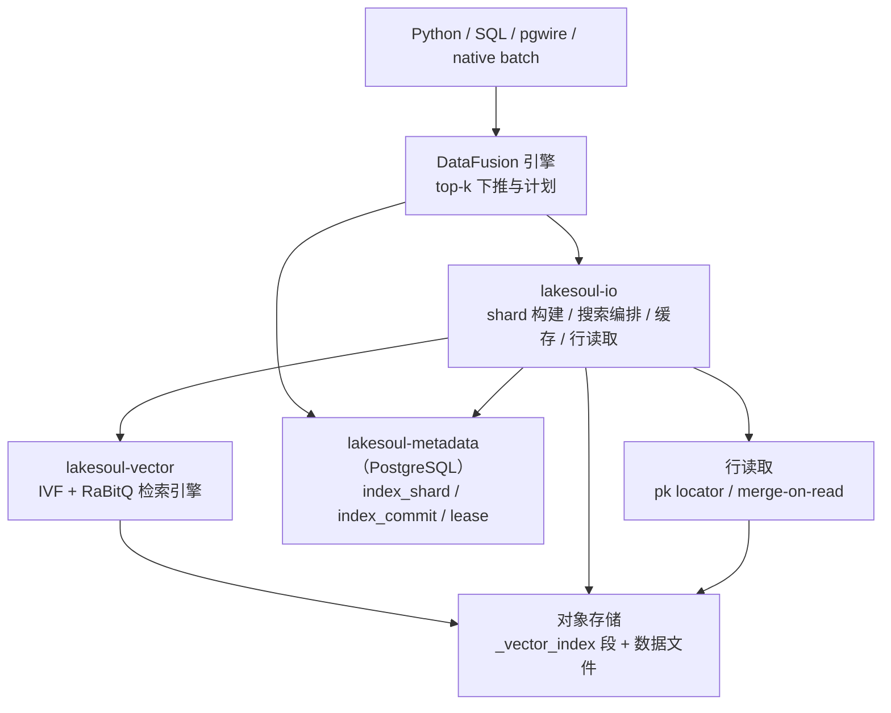

# 向量检索架构与缓存

<!--
SPDX-FileCopyrightText: 2026 LakeSoul Contributors

SPDX-License-Identifier: Apache-2.0
-->

本文面向使用者和集成方，说明 LakeSoul 向量检索的**分层结构、数据布局、索引与查询执行方式，以及三级缓存（L1 内存 / L2 本地 SSD / L3 对象存储）**。查询接口见 [API 参考](api.md)，参数与缓存配置见[配置](configuration.md)，快速上手见[快速开始](quickstart.md)。

## 1. 系统分层与数据流

向量检索不是独立服务，而是 LakeSoul 表上的**旁路二级索引**：数据文件（Parquet / Vortex）和索引对象（`_vector_index/`）都放在表的对象存储上，元数据放在 PostgreSQL。索引只负责召回候选主键，最终行内容仍由表的 merge-on-read、CDC 删除墓碑和快照语义决定。



| 层 | 组件 | 职责 |
|---|---|---|
| 接入层 | Python SDK、DataFusion SQL、pgwire、批量 SQL 函数 | 解析查询、构造 reader options、执行 SQL/批量调用 |
| 编排层 | DataFusion 规则、`LakeSoulVectorSearchExec`、`LakeSoulReader`、Daft source | 解析 shard、取读租约/lease、注入候选、合并结果 |
| 索引访问层 | `lakesoul-io`（`vector/search.rs`、shard builder、cache、pk locator） | 加载 `ResolvedIndex`、构建/提交索引、缓存、行读取 |
| 检索引擎层 | `lakesoul-vector` | IVF 探测、RaBitQ 距离估计、FastScan、top-k |
| 存储层 | 对象存储 + PostgreSQL | 数据文件与索引对象；索引控制面与提交元数据 |

依赖方向是单向的：`lakesoul-vector` 不依赖 `lakesoul-io`，`lakesoul-io` 不依赖 DataFusion；SQL、Python、pgwire 最终都落到同一个 `LakeSoulReader` 路径，因此 semantics 一致。

## 2. 数据模型与对象布局

### 2.1 表、分区、bucket 与 shard

一个表的每个向量列按 **`(partition_desc, hash_bucket_id)`** 切分为索引 shard：

```text
table
├── partition=2024-01-01, bucket 0  → shard 0
├── partition=2024-01-01, bucket 1  → shard 1
├── partition=2024-01-02, bucket 0  → shard 2
└── ...
```

- `partition_desc` 是分区目录相对表根的路径，无分区表为 `-5`；
- `bucket_id` 从数据文件名解析（`hash_bucket_num` 决定分桶数）；
- 每个 shard 有独立的 IVF 质心、独立的索引 commit 和独立的候选预算；可以独立增量、rebuild、GC。

这样分片与 LakeSoul 的写入分片一致：写入按 bucket 产生文件，索引构建按 `(partition, bucket)` 并行；查询时一个 reader 只负责一个 bucket，索引加载局部化。

### 2.2 对象存储布局

```text
{table_path}/
├── part-..._0000.parquet / .vortex              # 数据文件（不可变）
└── _vector_index/
    └── {vector_column}/
        └── {partition_desc}/
            └── {bucket_id}/
                ├── cluster_0000_0000_<rand>.seg   # base segment
                ├── cluster_0000_0001_<rand>.seg   # delta segment
                ├── cluster_0001_0000_<rand>.seg
                └── _mutations/
                    └── g{generation:08}/
                        ├── <txid>.delta           # mutation delta（LSMD）
                        └── <txid>.checkpoint      # mutation checkpoint（LSMC）
```

- segment 不可变，文件名带随机后缀，并发构建不会互相覆盖；
- catalog 的 segment JSON 记录每个 segment 的 `data_files`（覆盖了哪些数据文件），用于发现“索引还没构建”的新文件；
- `_mutations/` 是 upsert/delete 的旁路对象，不进入 `.seg`。

### 2.3 索引控制面（PostgreSQL）

| 表 | 作用 |
|---|---|
| `index_shard` | 一个 shard 一行，`unique (kind, index_prefix)`；`index_prefix` 即 `_vector_index/{column}/{partition}/{bucket}` |
| `index_commit` | 每次索引提交一行：`commit_id`、`generation`、`version`、`header`（索引头）、`segments`（该 generation 的累计 segment 列表）、`mutation_head` / `mutation_records` |
| `index_lease` | 构建/加载期间的短租约，防止 GC 删除正在使用的对象 |
| `index_read_lease` | 读快照租约（原生 batch 等固定快照读取），固定索引 commit 和原始数据文件，TTL 120 秒、每 30 秒续租 |

要点：

- `index_commit` 每行携带**累计 segment 列表**，`resolve(prefix)` 只读一行即可得到完整索引视图；
- 新提交插入新行，旧行由 rebuild 标记 `superseded_at` 保留（供旧 reader / 时间旅行使用）；
- 索引数据本身不在 PG 中，只在对象存储；PG 里是控制面和提交记录。

### 2.4 IndexKey：主键的 arrow-Row 编码

索引里存的是**主键列的 arrow-Row 编码**，不是行号：

```text
IndexKey = arrow_row_encode(pk_col_1, pk_col_2, ...)
```

- 支持单列和复合主键；编码顺序保持，可直接排序/二分；
- 索引 header 记录 `key_kind`（主键布局指纹），查询时与表当前 schema 比对；不一致时**不使用索引**，回退普通扫描；
- 读取行时用同一 codec 解码为 `pk IN (...)`，或直接交给 pk locator 做行定位。

### 2.5 Segment 格式与提交协议

segment 为 `SEG2` 格式（不可变），包含 cluster id/version、`padded_dim`、质心、每向量 1-bit code、ex-code、量化因子与 CRC；`birth_version` 不在 segment 内，而是记录在 catalog 的 segment JSON 中。索引 header 单独序列化（magic `RBQH`，含 `dim`、`metric`、`rotator`、`total_bits`、`key_kind`）。

提交协议：

```text
1. 写 segment 文件（随机后缀，不可变）
2. 如有 upsert/delete，写 mutation sidecar
3. catalog.commit_with_mutations(segments, mutation_head, mutation_records,
                                 expected = (generation, version))
```

`commit_with_mutations` 在同一个 PG 事务里校验 `expected` 后插入新 `(generation, version)` 行；版本冲突返回 `IndexVersionConflict`，调用方重新 `resolve` 后重写 sidecar 并重试（最多 3 次）。segment 文件名随机，所以并发的 segment 写入不会冲突。

## 3. 索引结构：IVF + RaBitQ

### 3.1 IVF 与量化

每个 shard 有 `nlist` 个 cluster（默认 256，实际 clamp 到 `min(nlist, 向量数)`），每个 cluster 有一个 `padded_dim` 维质心：

- 构建/插入时用最近质心做 coarse assignment；
- 查询时只探测最近的 `nprobe` 个 cluster，成本可控。

每个向量被量化成：

1. **1-bit binary code**：用于 FastScan 快速粗估；
2. **ex-code**：`total_bits - 1` 位/维，用于对加速剪枝后的候选做精化；
3. **per-vector factors**：`f_add` / `f_rescale` / `f_error`（1-bit 估计）与 `f_add_ex` / `f_rescale_ex`（ex-code 精化）。

因此索引距离是量化的：exact 模式会对候选重算精确距离，index-only 模式直接使用量化距离。

### 3.2 FastScan 批布局

为 SIMD 友好，每个 cluster 的向量按 **32 个一批**打包：每批包含 binary codes 以及 `f_add`/`f_rescale`/`f_error` 因子的数组，ex-code 单独按向量存放（只对通过下界剪枝的候选读取）。

### 3.3 base / delta segment、fresh / incremental / rebuild

- **base segment**（`segment_version = 0`）：每个 cluster 一个，含质心与初始向量；rebuild 时重写一套 base；
- **delta segment**（`segment_version = max + 1`）：只包含新增向量，查询时与 base 合并；
- **fresh build**：无 base 时重新读 shard 全部活跃文件、K-Means 训练质心、流式量化并写 base；
- **incremental build**：只读 base 质心，新向量 rotate → 找最近质心 → 量化 → flush 为 delta；
- **rebuild**：重读 shard 全部活跃文件、重新训练质心、写全新 base、进入新 generation、清空 mutation 链，旧 generation 由 GC 回收。

### 3.4 自动 rebuild 与 lazy cluster

`rebuild_mode = "auto"`（默认）时，每次写入前检查**任一 cluster** 的 `delta_vectors / base_vectors` 是否超过 `max_delta_ratio`（默认 1.0）；超过则对该 shard 全量 rebuild，重新训练质心并压缩 mutation。`rebuild_mode = "none"` 只追加 delta。

**cluster-lazy**：`LAKESOUL_VECTOR_LAZY_INDEX=auto`（默认）时，cluster 数 ≥64 的 shard 只加载查询实际 probe 到的 cluster（质心常驻、cluster 数据按需读取），避免为每个查询加载完整索引；小 shard 仍 eager 加载。

## 4. 查询执行

### 4.1 总流程

```text
SQL / Python / pgwire / batch
  → 规划器识别 ORDER BY 距离 LIMIT k（或 batch 入口）
  → resolve shard 得到 ResolvedIndex（commit_id / header / segments / mutation）
  → 取读租约（索引不在进程缓存时）
  → 加载索引（L1/L2/IndexSsdCache，miss 时读对象存储）
  → ANN 探测 nprobe 个 cluster → 候选 IndexKey + 索引距离
  → 未覆盖文件精确补算
  → 按 (key, birth_version) 去重，过滤 mutation 掩码
  → 行读取（pk locator / pk IN）→ merge-on-read 取最新行
  → index-only 直接排序 / exact 对候选精确重排
  → 全局 top-k
```

### 4.2 index-only 与 exact

| 模式 | 排序来源 | 是否读向量列 | 说明 |
|---|---|---|---|
| index-only（默认） | 索引量化距离 | 否 | 更快、IO 更少；距离是近似值 |
| exact | 候选行的原始向量 | 是 | 召回/排序更准确；首查需构建候选 block 缓存 |

- SQL / 会话的默认 `rerank` 是 `index`；`SET lakesoul_vector_search.rerank = 'exact'` 或 Python `rerank="exact"` 启用精确重排；
- exact 会用 `deferred_payload` 做两阶段读取：先排序保留候选，再读其余列；
- 多列检索时每列独立 ANN，候选取**交集**，再按加权距离排序（index-only 仅支持 L2）。

### 4.3 候选生成与未覆盖文件补算

索引是写入后异步构建的，因此某个 commit 的数据文件可能尚未被索引覆盖：

```text
covered = 所有 segment.data_files 的并集
pending = 本次查询的文件 - covered
if pending 非空:
    直接读这些文件、精确计算距离，作为 birth_version = u64::MAX 的候选
```

`u64::MAX` 保证补算出的新行在去重时胜过索引里的旧副本；没有向量列的稀疏文件会被跳过。

### 4.4 去重与可见性

索引 append-only，更新/删除的旧副本仍物理存在。加载索引时按 mutation 链构建掩码：

```text
可见 = mutation 中没有该 key 的记录
       或 birth_version >= mutation.latest_revision(key)
```

候选按 `HashMap<IndexKey, (birth_version, score)>` 去重，key 相同时保留 `birth_version` 更大的副本。mutation 链损坏时回退精确扫描，不返回含已删除 key 的索引结果。

### 4.5 行读取

- **pk locator（优先）**：每个数据文件维护一份排序的 `pk → 行号` 映射（按需从主键列构建），候选直接二分定位到行范围；支持 Parquet 和 Vortex，只读命中的行；
- **pk IN 过滤（回退）**：把候选编码成 `pk IN (...)` 注入 scan，交给 merge-on-read 读取（复合主键时为各列 IN 的笛卡尔积，正确性由 merge 保证）；
- **merge-on-read**：同一主键多版本合并保留最新、过滤 CDC 删除墓碑，最终返回最新行。

### 4.6 批量查询

原生批量入口按**有界 window** 执行：一次调用最多处理 `query_window`（默认 256）个 query，window 内按 bucket/文件分组并行探测，复用同一份快照、索引和 FastScan block，再合并全局 top-k；`io_concurrency`（默认 8）限制并发对象/block 读，`memory_bytes`（默认 128 MiB）限制瞬时内存。超过 window 的 query 会切成多个 window 顺序执行，而不是逐条 SQL。

## 5. 缓存机制（重点）

向量缓存是**进程内**的，分三层：

| 层 | 内容 | 介质 | 作用 |
|---|---|---|---|
| L1 | 已解析索引、lazy cluster、查询快照、decoded block、block source / 文件句柄 | 进程内存 | 热查询零解析/零 IO |
| L2 | 通用 DiskCache（数据页 / PK key index / decoded block）+ 可选 IndexSsdCache（索引整文件） | 本地 SSD | 冷进程避免重复下载 |
| L3 | 数据文件与 `_vector_index/` 对象 | 对象存储 | source of truth |

L1 / L2 只影响速度，对象存储是唯一事实来源；所有缓存条目都可以在任意时刻丢弃并从 L3 重新构建。

### 5.1 L1：eager parsed index cache

- 进程级 `moka` 加权 LRU（按条目 `memory_bytes` 计权），容量来自 L1 cluster 预算；
- key 为 `(kind, store 身份, index prefix)`。store 身份有两种来源：通用索引路径按 store 配置推导（同一 store 的不同 handle 得到同一身份，不同 endpoint/bucket/本地 root 不会互相复用）；向量路径使用进程内 store namespace token（同一 `ObjectStore` 分配期间稳定，不同 store 不复用）；
- 复用前校验 `commit_id`：commit 前进（增量提交、rebuild、drop 后重建）时旧条目不再命中，按新 commit 重新加载并替换；
- 并发 miss 使用 singleflight（`try_get_with`），同一 key 的并发查询只加载一次；
- 条目超过预算时不会被保留（moka 立即淘汰），之后每次查询重新加载并告警；eviction 计入 `lakesoul_index_cache_evictions_total`；
- 命中时不需要读对象存储，也不需要 reader lease。

### 5.2 L1：lazy cluster、snapshot、block 与句柄缓存

- **lazy cluster**：单独的进程级映射（key 含 prefix、store 身份、commit、key_kind），只保存质心选择器和共享 cluster cache 的引用；条目数有上限，超限整体清空后重建；
- **查询快照 / provider**：DataFusion 侧的 snapshot shard 缓存（最多 2 份）复用同一查询计划内的解析结果；表元数据另有 `LAKESOUL_METADATA_TTL_MS` 控制的新鲜度窗口（默认关闭）；`LAKESOUL_VECTOR_SNAPSHOT_CACHE=0` 可关闭快照缓存；
- **decoded block L1**：exact 候选块，key 为 `(source_hash, field_hash, block_id)`，其中 `source_hash` 含 store 身份，容量为 L1 block 预算；
- **block source / 文件句柄**：`VectorBlockSource` 打开结果按数据文件+列布局缓存（最多 16 个，`LAKESOUL_VECTOR_BLOCK_SOURCE_CACHE=0` 关闭）；Vortex 文件句柄与主键行索引按 `(store 身份, 文件路径)` 缓存，数据文件不可变，因此不需要失效。

### 5.3 L1 预算

使用统一的 `LAKESOUL_VECTOR_CACHE` / `LAKESOUL_VECTOR_MEMORY_BYTES` 配置面时（默认 `512MiB`）：

```text
LAKESOUL_VECTOR_MEMORY_BYTES
  ├─ cluster cache（eager parsed index）  ≈60%   （LAKESOUL_VECTOR_CLUSTER_CACHE_BYTES 可覆盖）
  ├─ decoded block cache                ≈30%   （LAKESOUL_VECTOR_BLOCK_CACHE_BYTES 可覆盖）
  ├─ snapshot                           ≈10%，clamp 到 64MiB–512MiB
  └─ query / Arrow 缓冲                  剩余
```

旧配置面（只设置旧变量、未启用统一配置面）保持历史默认：512 MiB 已解析索引、512 MiB snapshot、256 MiB block cache。L1 总量由进程内各缓存实例共享，`LAKESOUL_VECTOR_CACHE=0` 会关闭 L1 向量缓存（index-only 变慢，exact 回退普通 reader 路径）。

### 5.4 L2：共享 DiskCache

通用本地盘缓存（read-through page cache + decoded block + PK key index 共用）：

| 项 | 说明 |
|---|---|
| 启用 | `LAKESOUL_CACHE` 设置后启用（容量 0 关闭） |
| 目录 | `LAKESOUL_CACHE_PATH`，默认 `lakesoul_cache_dir` |
| 容量 | `LAKESOUL_CACHE_SIZE`，默认 1 GiB；按字节加权 LRU 淘汰 |
| 页大小 | 4 MiB 数据页 |
| 共享内容 | Parquet/Vortex 数据页、PK key index、exact decoded block |
| key | 对象路径带 **store 身份 token**（`_lakesoul_store_cache/{token}/...`）；不同 bucket/endpoint 的同名路径不会互相复用，cache entry 保留 store 引用防止指针复用 |

同一进程内重建缓存实例仍能命中已有 L2 文件，因为同一 `ObjectStore` 分配期间 token 稳定。

### 5.5 可选：IndexSsdCache（索引整文件缓存）

索引段是**不可变整文件**，与通用数据页缓存的需求不同，因此提供可选的独立缓存：

- 缓存粒度是**整个索引文件**（segment / mutation），不是 16 KiB 或 4 MiB 页；
- `LAKESOUL_INDEX_SSD_BYTES` 设置容量后启用（默认 0 = 关闭；属于专家级 override，预算独立于通用 L2）；
- 目录 `LAKESOUL_INDEX_SSD_DIR`，默认 `<LAKESOUL_CACHE_PATH>/index-cache`；
- 写入流程：临时文件 → `fsync` → 原子 `rename`，不会读到半写文件；eviction 时删除本地文件；
- 启动时**惰性 adopt**：首次访问扫描目录里格式正确的 16 位十六进制 `.bin` 条目，按 mtime 和当前预算采用/淘汰，未知文件、符号链接、活动临时文件不删除；进程内用 moka 维持精确 LRU；
- 通过 `IndexCachedStore` 包装 object store，**只对索引加载生效**；HEAD / 条件 GET 直接委托 inner store，避免为元数据下载整文件。

### 5.6 L3：对象存储与 page cache 旁路

对象存储是唯一事实来源。为了不污染共享 L2：

- `_vector_index/` 下的索引段读取**绕过 read-through page cache**（按路径段匹配），直接走 inner store：这些对象每个冷 shard 只读一次，缓存它们只会增加一次 HEAD + 一次本地页写；需要本地持久缓存时用上节的 `IndexSsdCache`；
- exact 候选行读取走 **raw store alias**：候选是大量一次性小 range 读，直接读对象存储、不做页缓存记账；解码后的候选 block 进入 L1 decoded-block 缓存和共享 L2（`vector-blocks/...` 独立 key 空间，设置 `LAKESOUL_CACHE` 后启用）；
- 普通（非向量）数据文件的读取仍走通用 page cache，向量索引的旁路不会影响湖仓其他查询的缓存预算。

### 5.7 生命周期与失效

| 事件 | L1 | L2 |
|---|---|---|
| 命中 | 直接返回，不访问 L2/L3 | 读本地文件/页并回填 L1 |
| commit 前进（增量/rebuild） | 新 commit 不命中旧条目，下次查询重新加载 | 旧文件由 LRU 淘汰；新 commit 是新文件 |
| drop index | 按 prefix 清理 L1 index、lazy shard、snapshot 缓存 | 旧对象由 GC / LRU 回收 |
| 进程重启 | 全部丢失 | **全部重建**：disk key 含 process nonce，两个 L2（含 IndexSsdCache）都不跨进程复用；旧目录内容只在首次访问时被惰性扫描、按 mtime 与预算采用/淘汰 |
| 内存/磁盘超预算 | 按字节 LRU 淘汰 | 按字节 LRU 淘汰并删除本地文件 |

进程内缓存命中统计（hits/misses/evictions）通过 metrics 暴露；L2 的读写/命中统计在缓存实例内累计。

## 6. 并发、一致性与 GC

- **提交并发**：`index_commit` 有 `unique(shard_id, generation, version)`；提交校验 `expected`，冲突时调用方重写 sidecar 并重试；segment 随机后缀避免覆盖。
- **读一致性**：查询先 `resolve` 到某个 `commit_id`，加载该 commit 的 segment 列表；加载期间持有 lease（单查默认 300 秒，可用 `LAKESOUL_VECTOR_INDEX_LEASE_TTL_SECS` 覆盖），加载完成进入缓存后即可释放；原生 batch / 固定快照读使用 `index_read_lease`（120 秒 TTL、30 秒续租），续租失败取消批查询。
- **drop tombstone**：`drop_vector_index` 只删派生索引。默认移除声明；保留声明时 `vector_index_available=false`，planner 自动回退普通扫描。drop 写入 tombstone 阻止旧 writer 重建，递增 `vector_index_epoch` 使 metadata/snapshot/L1/lazy 缓存失效；物理清理等待 grace 与活跃读租约释放，失败/延迟的清理可由 GC 幂等重试。
- **GC**：`gc_vector_index` 每个 shard 保留 `keep_generations`（默认 1）个 generation，删除 `superseded_at` 超过 grace（默认 3600 秒）的 commit 行和不再被引用的 segment / 旧 generation 的 `_mutations/`；写入路径按 `LAKESOUL_INDEX_GC_EVERY`（默认每 16 次写）摊销执行。
- **构建失败**：索引构建失败会报错/记录，但不回滚已提交的数据；构建成功但提交失败产生的 segment 成为孤儿，由后续 GC 回收。

## 7. 设计取舍

| 选择 | 收益 | 代价 |
|---|---|---|
| IVF + RaBitQ + FastScan，索引旁路存放 | 索引可重建、可删除，不影响数据文件与事务；内存/带宽远小于原始 float | 近似距离，需要 exact rerank 或 overfetch；索引与数据的一致性由 catalog 维护 |
| 按 `(partition, bucket)` 分 shard | 与写入分片一致，构建/查询可并行，单 shard 可独立 rebuild/GC | shard 数多时元数据、对象数、线程数增加 |
| append-only + base/delta segment | 写入快，不重写历史 | 旧副本需要 mutation 掩码；mutation 状态增长后需要 rebuild 压缩 |
| 全局 revision + birth_version + mutation | 跨 cluster 的 upsert/delete 可见性正确，删除无需重写 segment | 查询加载时多一步掩码；链损坏需回退精确扫描 |
| 默认 index-only（`rerank='index'`），exact 可选 | 默认查询不读向量列，延迟低、吞吐高 | 距离是量化值；高召回场景需切到 exact |
| IndexKey 用 arrow-Row 编码 | 顺序保持、支持复合主键、与 LakeSoul 文件布局一致 | 主键 schema 变化导致 `key_kind` 不匹配，需要 rebuild |
| 三级缓存 + `_vector_index`/候选块 IO 旁路 page cache | 无重复缓存、不挤占共享 L2 预算，冷启动与热查询行为可预期 | 缓存是进程内的，多节点/多进程不共享；重启后需要重新预热 |

## 相关文档

- [快速开始](quickstart.md)：建表、写入、Python / SQL / pgwire 查询；
- [API 参考](api.md)：完整接口、索引构建/删除、读租约与 tombstone 语义；
- [配置](configuration.md)：索引参数、缓存预算与 block 调优；
- [性能基准](benchmarks.md)：index-only / exact、单查 / batch 的实测数字。
